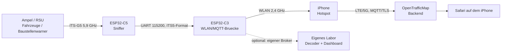

# Ice-Traffic-Data

Mobiler Empfang von **C-ITS / ITS-G5 (802.11p)** Verkehrsdaten im Auto – Ampeldaten (SPATEM/MAPEM), Fahrzeugmeldungen (CAM) und Gefahrenmeldungen (DENM) – mit zwei günstigen ESP32-Boards und Anzeige über das iPhone.

> **Status:** Planung / Dokumentation. Noch nichts getestet. Offene Punkte stehen in [docs/07-offene-punkte.md](docs/07-offene-punkte.md).

## Idee in einem Bild

## Anleitung (Schritt für Schritt)

| Schritt | Thema |
|---|---|
| 1 | [Grundlagen: Verkehrsdaten-Techniken & Nachrichtentypen](docs/01-grundlagen.md) |
| 2 | [Hardware & Einkaufsliste](docs/02-hardware.md) |
| 3 | [Verdrahtung](docs/03-verdrahtung.md) |
| 4 | [Firmware bauen & flashen](docs/04-firmware.md) |
| 5 | [iPhone-Hotspot & MQTT/OpenTrafficMap](docs/05-iphone-mqtt.md) |
| 6 | [Testfahrt München / Ottobrunn](docs/06-testfahrt.md) |
| 7 | [Offene Punkte & Ausbau](docs/07-offene-punkte.md) |

## Quellen

- Firmware: <https://github.com/bertrik/its-g5-receiver> (Ordner `esp32-c5-sniffer/`, `esp32-c3-bridge/`)
- Projektbeschreibung des Autors: <https://revspace.nl/Its-g5>
- OpenTrafficMap Wiki: <https://wiki.opentrafficmap.org>
- Alternative (Android): V2X2MAP, CITS-to-go
