# 0 – Architektur, Setup und Datenfluss

## Setup im Auto (Hardware)
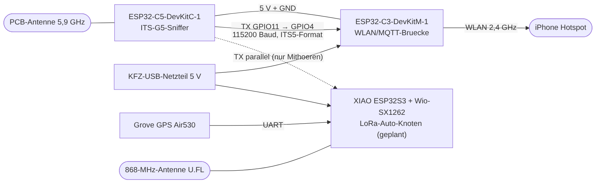

Mermaid-Quelltext

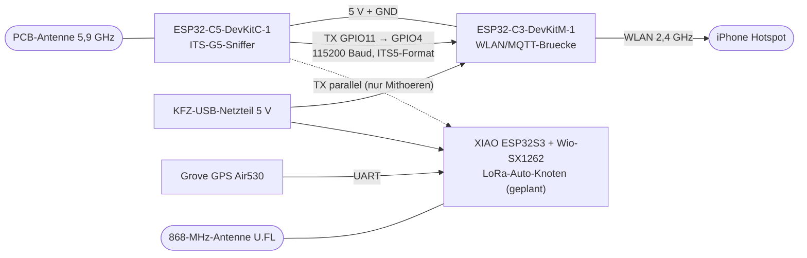

## Systemübersicht (Auto → Heimnetz → Anzeige)
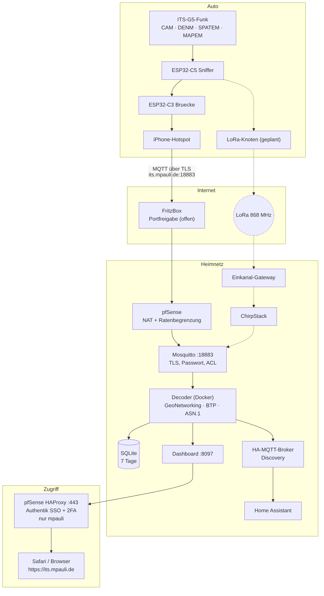

Mermaid-Quelltext

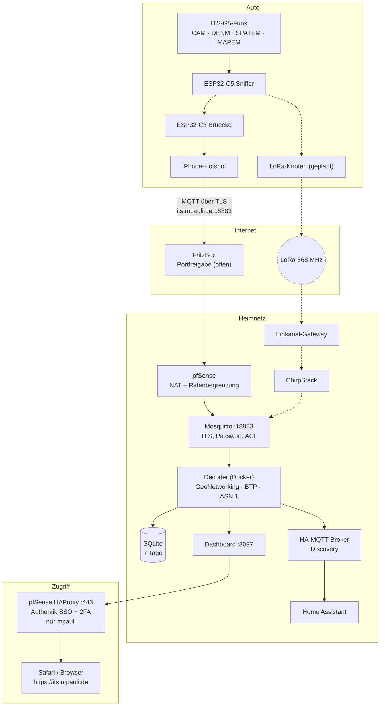

Gestrichelt = geplant bzw. noch nicht gebaut oder nicht freigeschaltet.

## Datenfluss eines Pakets
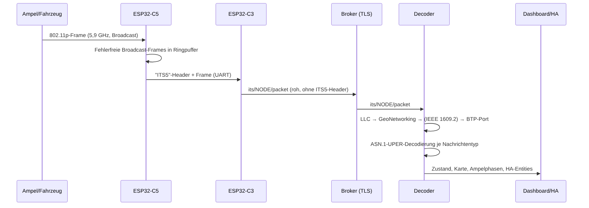

Mermaid-Quelltext

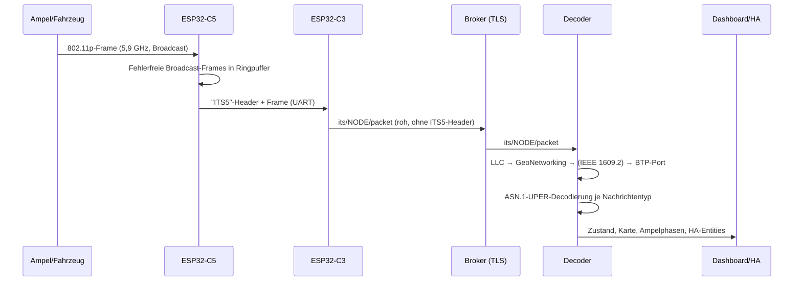

## Dekodier-Pipeline (Detail)

Mermaid-Quelltext

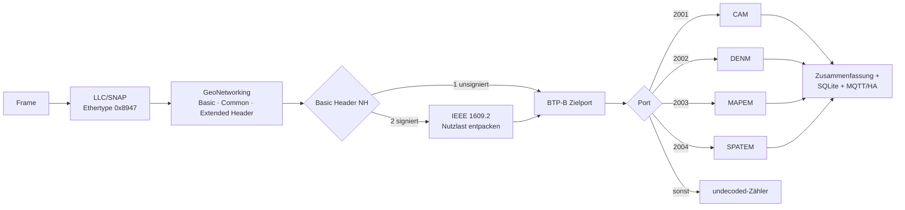

## Sicherheitsschichten
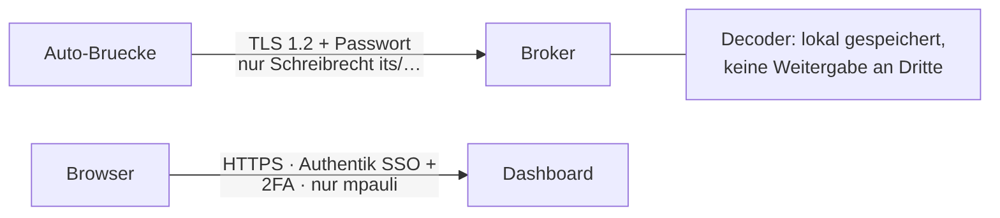

Mermaid-Quelltext

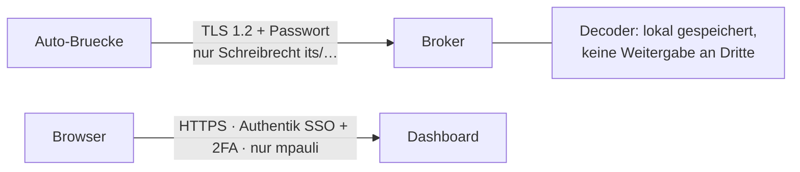

## LoRa-Anbindung (Zusatzkanal)
Der LoRa-Auto-Knoten schickt nur **Zusammenfassungen** (Zähler je Nachrichtentyp, Position, Funkqualität) – die vollen Daten kommen weiter über das Handy. Details und Einordnung: [10](10-lorawan.md).

### Verbindungen
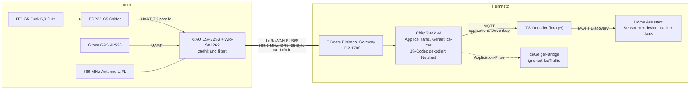

Mermaid-Quelltext

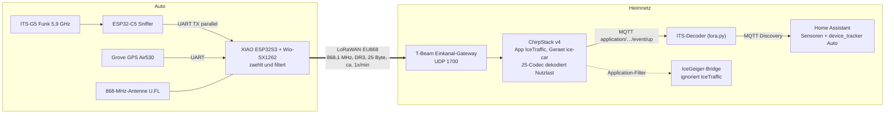

### Datenfluss eines LoRa-Uplinks
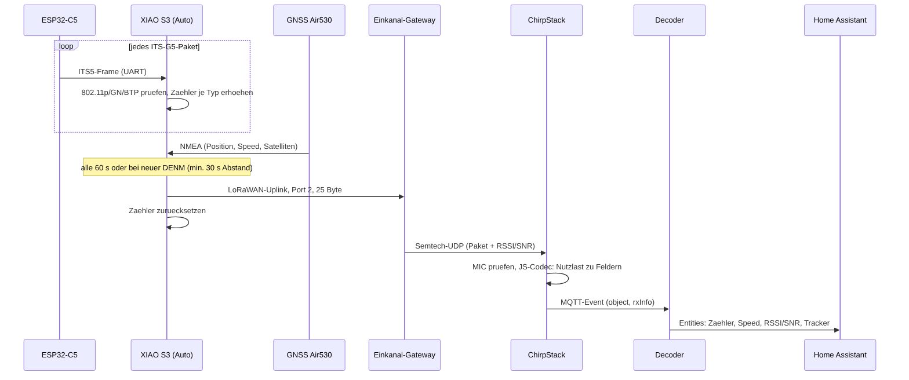

Mermaid-Quelltext

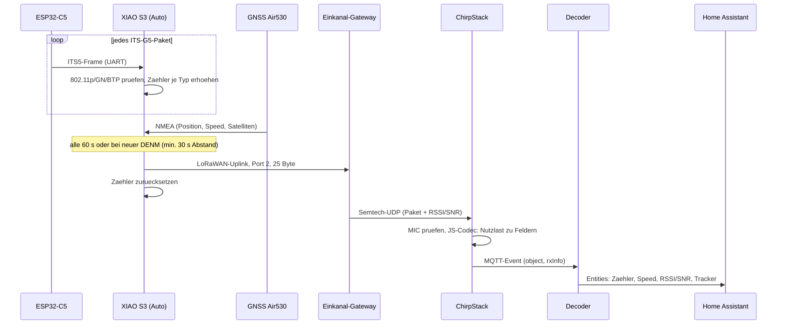

### Beide Wege im Vergleich
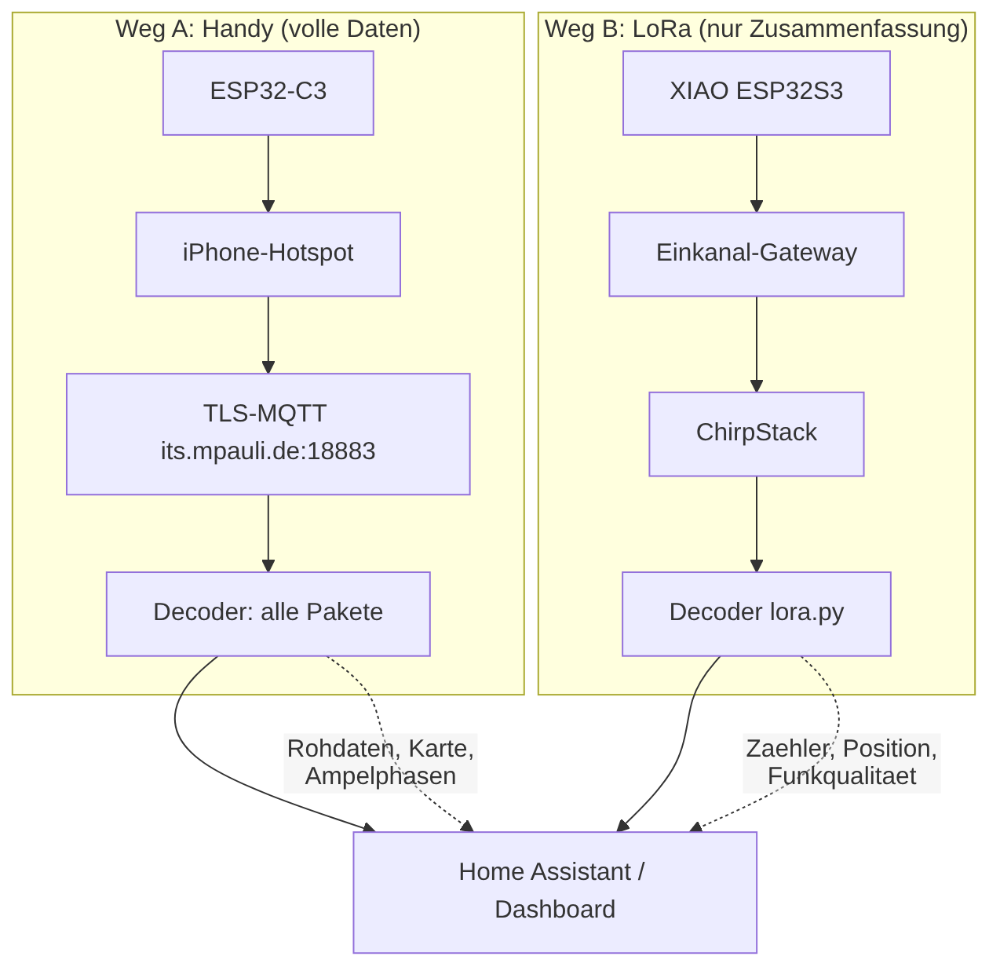

Mermaid-Quelltext

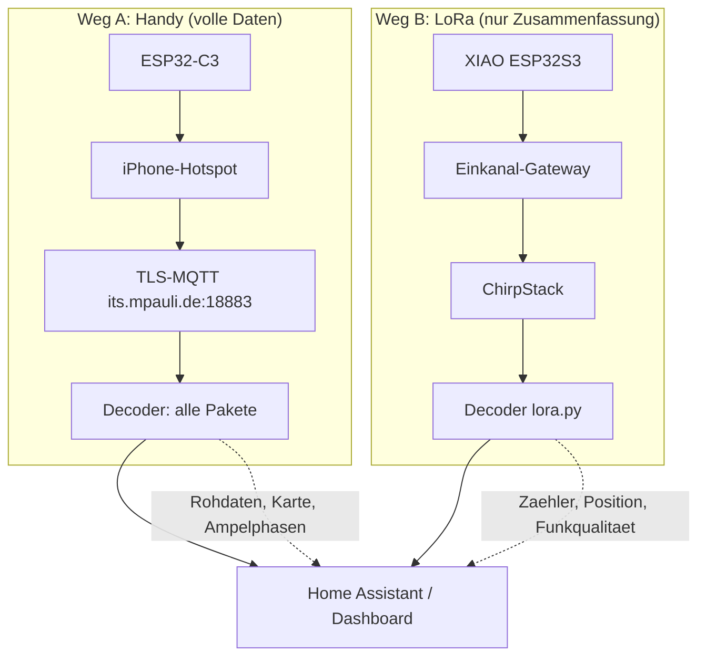

