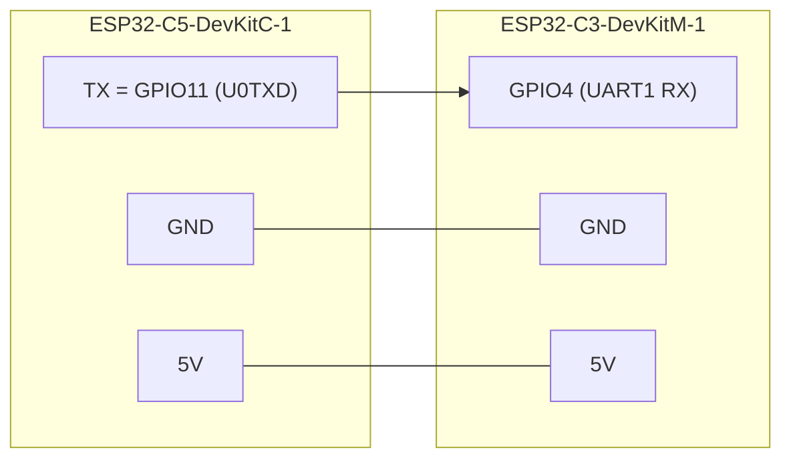

# 3 – Verdrahtung

3 Drähte: **GND, 5 V, Daten (C5 TX → C3 GPIO4)**, 115200 Baud, 3,3-V-Logik.

## Warum GPIO4 und nicht GPIO20 wie beim Autor?
Der Autor nutzt ein C3-Supermini mit nativem USB: dort ist UART0 (GPIO20/21) frei. Beim **DevKitM-1** hängt UART0 am USB-UART-Chip (CP2102). Ein zweiter Treiber auf GPIO20 würde mit dem CP2102 kollidieren und die Konsole stören. Darum liest unser [Patch](../firmware/0001-devkitm1-uart1.patch) die Daten von **UART1 auf GPIO4**.

## Pin-Fakten (Espressif-Doku, geprüft)
- C5: U0TXD = GPIO11 (J3 Pin 2), U0RXD = GPIO12, RGB-LED = GPIO27, native USB = GPIO13/14, 5 V = J1 Pin 14, GND = J3 Pin 1/12/15.
- ⚠ Der Autor merkt an, dass abweichende Boardrevisionen andere UART-Pins haben können → **beim Eintreffen der Boards mit Multimeter/Schaltplan gegenprüfen.**

## Stromversorgung & Flashen
- Im Auto: Netzteil → C3 (Micro-USB). Der C3 speist den C5 über die 5-V-Brücke (der C5 hat eigenen Regler).
- **Beim Flashen die 5-V-Brücke abziehen** und jeweils nur ein Board per USB anschließen (Rückspeisung vermeiden).
