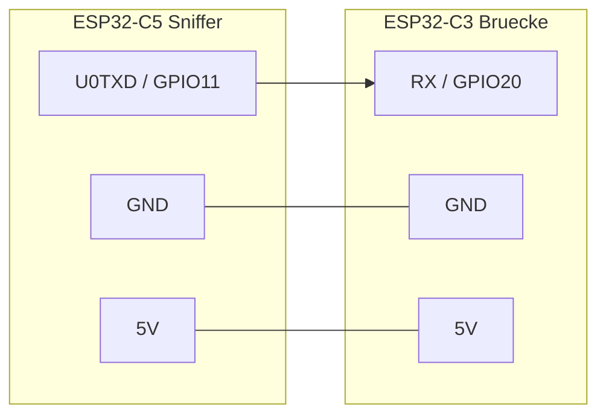

# 3 – Verdrahtung

Nur **3 Drähte**: GND, 5 V, Daten (C5 TX → C3 RX, 3,3-V-Logik, 115200 Baud).

> ⚠ Die GPIOs stammen aus dem Aufbau des Autors. Seine C5-Platine routet USB-UART auf GPIO11/12 statt 24/25 wie im Espressif-Schaltplan. **Mit eigenem Board gegen Schaltplan/Firmware-Konfiguration prüfen.**
> ⚠ Beim Flashen nicht beide Boards gleichzeitig per USB **und** über die 5-V-Brücke speisen (Rückspeisung). Beim Flashen die 5-V-Leitung trennen.

Der C3 hängt per USB-C am KFZ-Netzteil und versorgt den C5 über die 5-V-Brücke (der C5 hat einen eigenen Regler).
