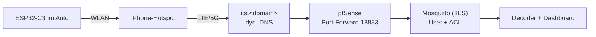

# 8 – Anbindung an den Heimserver

## Bausteine
1. **Dyn. DNS:** vorhanden ist das Hetzner-DDNS-Skript (hält `*.mpauli.de`-Einträge auf der Heim-IP) – einen weiteren Eintrag `its.<domain>` ergänzen. Alternative DuckDNS (braucht Token).
2. **TLS-Zertifikat:** Let's Encrypt per DNS-01 (Hetzner-API). Das C3-Image enthält bereits das **ISRG Root X1** (`isrgrootx1.pem`), Let's-Encrypt-Zertifikate sind also direkt prüfbar.
3. **Mosquitto öffentlich:** eigener Container (nicht der HA-Broker!), `allow_anonymous false`, `password_file`, ACL: Auto-User darf nur schreiben. Port 18883, da 8883 auf dem NUC vom HA-Broker belegt ist.
4. **pfSense:** NAT-Weiterleitung statt HAProxy (HAProxy bedient nur HTTPS auf :443); bei Blockaden Suricata/pfBlockerNG prüfen.
5. **Härtung:** Rate-Limit, fail2ban-artige Sperre bei Fehlversuchen, Passwort lang/zufällig, Zugangsdaten nur auf dem Gerät.

## Umsetzungsstand (01.11.2026)
| Baustein | Stand |
|---|---|
| DNS `its.mpauli.de` | ✅ A-Record angelegt, vom Hetzner-DDNS-Skript mitgepflegt |
| TLS-Zertifikat | ✅ Let's Encrypt (EC-256, acme.sh DNS-01), Erneuerung installiert den Cert automatisch (`scripts/setup-broker.sh`) |
| Mosquitto | ✅ Listener 18883: TLS 1.2, Passwort, ACL (User `car` darf nur `its/+/packet\|status\|info\|stats` schreiben, nichts lesen). Getestet: richtige Zugangsdaten ok, falsches Passwort und anonymer Klartext abgewiesen |
| pfSense | ✅ NAT-Weiterleitung WAN :18883 → Broker :18883 mit Ratenbegrenzung (max. 5 gleichzeitige Verbindungen je Quelle, 6 neue pro 60 s). Backup der Config vor der Änderung |
| **FritzBox** | ❌ **Offen (manuell):** Portfreigabe TCP 18883 → pfSense-WAN-Adresse. Die FritzBox sitzt vor der pfSense (Doppel-NAT); ohne diese Freigabe ist der Broker aus dem Internet **nicht** erreichbar |
| Externer Test | ❌ erst nach der FritzBox-Freigabe: `openssl s_client -connect its.mpauli.de:18883` von außen |

Das Passwort des Users `car` liegt nur auf dem Server (`$ITS_DEPLOY/secrets/car.pass`, nicht im Repo) und wird in der Bridge-Weboberfläche eingetragen.

## Lokaler Betrieb ohne Internet (heute schon möglich)
`docker compose up -d` startet Broker (LAN-Port **1885**, anonym, nur Heimnetz) und Decoder. Die Bridge im Heim-WLAN auf `mqtt://<NUC-IP>:1885` stellen und am Schreibtisch testen.
