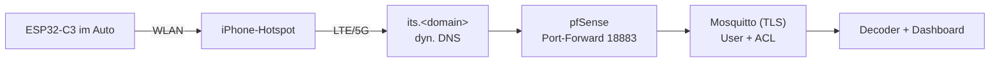
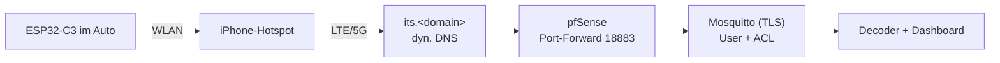
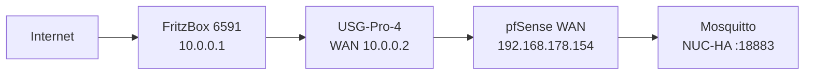

# 8 – Anbindung an den Heimserver

Mermaid-Quelltext

## Bausteine
1. **Dyn. DNS:** vorhanden ist das Hetzner-DDNS-Skript (hält `*.mpauli.de`-Einträge auf der Heim-IP) – einen weiteren Eintrag `its.<domain>` ergänzen. Alternative DuckDNS (braucht Token).
2. **TLS-Zertifikat:** Let's Encrypt per DNS-01 (Hetzner-API). Das C3-Image enthält bereits das **ISRG Root X1** (`isrgrootx1.pem`), Let's-Encrypt-Zertifikate sind also direkt prüfbar.
3. **Mosquitto öffentlich:** eigener Container (nicht der HA-Broker!), `allow_anonymous false`, `password_file`, ACL: Auto-User darf nur schreiben. Port 18883, da 8883 auf dem NUC vom HA-Broker belegt ist.
4. **pfSense:** NAT-Weiterleitung statt HAProxy (HAProxy bedient nur HTTPS auf :443); bei Blockaden Suricata/pfBlockerNG prüfen.
5. **Härtung:** Rate-Limit, fail2ban-artige Sperre bei Fehlversuchen, Passwort lang/zufällig, Zugangsdaten nur auf dem Gerät.

## Umsetzungsstand (01.11.2026)
| Baustein | Stand |
|---|---|
| DNS `its.mpauli.de` | ✅ A-Record angelegt, vom Hetzner-DDNS-Skript mitgepflegt |
| TLS-Zertifikat | ✅ Let's Encrypt (EC-256, acme.sh DNS-01), Erneuerung installiert den Cert automatisch (`scripts/setup-broker.sh`) |
| Mosquitto | ✅ Listener 18883: TLS 1.2, Passwort, ACL (User `car` darf nur `its/+/packet\|status\|info\|stats` schreiben, nichts lesen). Getestet: richtige Zugangsdaten ok, falsches Passwort und anonymer Klartext abgewiesen |
| pfSense | ✅ NAT-Weiterleitung WAN :18883 → Broker :18883 mit Ratenbegrenzung (max. 5 gleichzeitige Verbindungen je Quelle, 6 neue pro 60 s). Backup der Config vor der Änderung |
| UniFi (USG-Pro-4) | ✅ Port-Weiterleitung `ITS-MQTT-TLS`: WAN TCP 18883 → pfSense-WAN (Bad!Net), per Controller-API angelegt; Liste vorher gesichert |
| FritzBox | ✅ Weiterleitung TCP 18883 → USG-WAN per UPnP-IGD (`AddPortMapping`, Lease 0) angelegt, FritzBox bestätigt |
| pfSense Rückweg | ✅ Quell-NAT auf VLAN11 für Ziel Broker:18883. Ohne sie antwortet der NUC über sein Standard-Gateway (USG) statt über die pfSense (asymmetrisch) und der Verbindungsaufbau hängt in `SYN_SENT` |
| Externer Test | ✅ von einem Server in Deutschland: TLS-Zertifikat gültig (Let's Encrypt), Anmeldung mit den Zugangsdaten ok (CONNACK 0), Veröffentlichung kam im Broker an, falsches Passwort abgewiesen |

Das Passwort des Users `car` liegt nur auf dem Server (`$ITS_DEPLOY/secrets/car.pass`, nicht im Repo) und wird in der Bridge-Weboberfläche eingetragen.

## Tatsächliche Kette im Heimnetz
Entgegen der ersten Annahme sitzt zwischen FritzBox und pfSense noch die **USG-Pro-4** (UniFi, NAT). Jeder von außen erreichbare Port braucht daher **zwei** Weiterleitungen:

Mermaid-Quelltext

Die FritzBox hatte nur 443 offen; für andere Ports antwortete sie mit „administratively prohibited" (Fehler 113 beim Test). Die Weiterleitungen wurden angelegt: USG per Controller-API, FritzBox per UPnP (Lease 0). Beim Debuggen hilft die Fehlerart: *No route to host* = FritzBox weist ab, *Timeout* = weiter hinten verloren (USG/pfSense/Rückweg).

## Interner DNS (Split-Horizon)
Wie bei den übrigen Heim-Diensten (Skript `sso-dns-sync`, alle 15 Minuten): jeder A-Record in der Hetzner-Zone, der auf die Heim-IP zeigt, wird intern auf die pfSense-WAN-Adresse (192.168.178.154) umgebogen – in **pfSense-Unbound und AdGuard**. Geprüft: beide liefern für `its.mpauli.de` die 192.168.178.154, extern (1.1.1.1) die öffentliche Heim-IP.

Folge für MQTT: Aus dem Bad!Net (192.168.178.0/24) erreicht ein Gerät `its.mpauli.de:18883` über die WAN-Weiterleitung. Aus den 10.10.x-Netzen gibt es **keine** LAN-seitige Weiterleitung auf 18883 – dort bleibt der Test über `<NUC-IP>:1885` (ohne TLS).

## Lokaler Betrieb ohne Internet (heute schon möglich)
`docker compose up -d` startet Broker (LAN-Port **1885**, anonym, nur Heimnetz) und Decoder. Die Bridge im Heim-WLAN auf `mqtt://<NUC-IP>:1885` stellen und am Schreibtisch testen.
