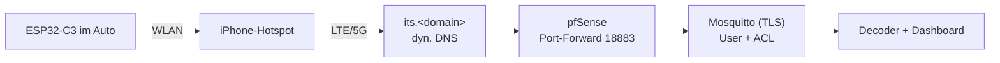

# 8 – Anbindung an den Heimserver (Entwurf, noch nicht umgesetzt)

## Bausteine
1. **Dyn. DNS:** vorhanden ist das Hetzner-DDNS-Skript (hält `*.mpauli.de`-Einträge auf der Heim-IP) – einen weiteren Eintrag `its.<domain>` ergänzen. Alternative DuckDNS (braucht Token).
2. **TLS-Zertifikat:** Let's Encrypt per DNS-01 (Hetzner-API). Das C3-Image enthält bereits das **ISRG Root X1** (`isrgrootx1.pem`), Let's-Encrypt-Zertifikate sind also direkt prüfbar.
3. **Mosquitto öffentlich:** eigener Container (nicht der HA-Broker!), `allow_anonymous false`, `password_file`, ACL: Auto-User darf nur `write its/+/packet|status|info|stats`. Auf dem NUC ist 8883 schon vom HA-Broker belegt → anderer Port (z. B. 18883).
4. **pfSense:** Port-Forward 18883 → Broker; ggf. Suricata-Ausnahme (siehe frühere Erfahrungen mit IPS-Blockaden).
5. **Härtung:** Rate-Limit, fail2ban-artige Sperre bei Fehlversuchen, Passwort lang/zufällig, Zugangsdaten nur auf dem Gerät.

> Bis hier **bewusst nichts geändert** (DNS, Firewall, offene Ports) – das ist eine Außenwirkung und braucht deine Freigabe.

## Lokaler Betrieb ohne Internet (heute schon möglich)
`docker compose up -d` startet Broker (LAN-Port **1885**, anonym, nur Heimnetz) und Decoder. Die Bridge im Heim-WLAN auf `mqtt://<NUC-IP>:1885` stellen und am Schreibtisch testen.
