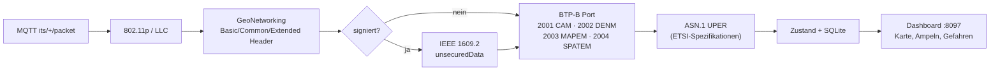
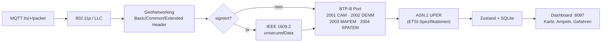

# 9 – Lokaler Decoder & Dashboard

Läuft als Container auf dem Heimserver, liest `its/+/packet` und dekodiert **CAM, DENM, SPATEM, MAPEM**.



<details><summary>Mermaid-Quelltext</summary>



</details>


## Start
```bash
docker compose up -d --build
# Dashboard: http://<server>:8097     Broker (LAN): <server>:1885
```
ASN.1-Dateien werden beim Build von ETSI-Forge/Vanetza geholt (`decoder/fetch_asn.sh`): CAM v1.4.1, DENM v1.3.1, SPATEM/MAPEM v2.2.1 mit ISO-TS-19091-DSRC.

## Was das Dashboard zeigt
Karte mit Fahrzeugen (CAM), Kreuzungen (MAPEM) und Gefahren (DENM); je Kreuzung die Signalgruppen-Zustände (SPATEM); Paketrate und Zähler je Typ (inkl. „undecoded", „secured", ASN.1-Fehler); die letzten 30 Ereignisse. Zusätzlich wird aus dem GeoNetworking-Header jeder Sender-Position (auch ohne CAM) übernommen.

## Home Assistant
Der Decoder meldet sich per MQTT-Discovery am Broker von Home Assistant an (Gerät „Ice-Traffic-Data"): Pakete/min, sichtbare Fahrzeuge, aktive Gefahrenmeldungen, Kreuzungen mit Ampeldaten, bekannte Kreuzungen, Frames gesamt, nicht dekodiert, „Letztes Paket vor", „Empfänger online" und die letzte Gefahrenmeldung (Details als Attribute). Zugangsdaten stehen in einer lokalen `.env` (nicht im Repo; Vorlage: `HA_MQTT_*` in `docker-compose.yml`). Aktualisierung alle 10 s; Sensoren gehen auf „nicht verfügbar", wenn der Decoder stoppt.

Hinweis: Dass HA die Entities tatsächlich anlegt, wurde nur über die retained Discovery-Meldungen (10 Stück im Broker) geprüft, nicht in der HA-Oberfläche.

## Datenschutz
Alles bleibt lokal. SQLite (`msgs`) hält Rohdekodierungen 7 Tage (`retention`), danach Löschung. CAM-Daten fremder Fahrzeuge sind pseudonymisiert, aber ortsbezogen – nicht weitergeben.

## Teststand – ehrlich
- ✅ Unit-Tests (`decoder/tests`): synthetisch kodierte CAM/SPATEM → Frame → Dekodierung → Zusammenfassung; IEEE-1609.2-Hülle; defekte Frames. Ende-zu-Ende über Docker+MQTT mit synthetischem CAM.
- ❌ **Nicht mit echten Funkdaten geprüft.** Offene Risiken: (a) Aufbau der signierten Pakete (Position von Common/Extended Header relativ zur 1609.2-Hülle), (b) SPATEM/MAPEM-Versionen in Deutschland (v1.3.x vs. 2.x, regionale Erweiterungen), (c) CAM-Version im Feld. Beim ersten Mitschnitt: Hexdump + Wireshark vergleichen; Zähler `undecoded` / `decode_error_*` zeigen Abweichungen.
- Der ITS5-Header (Zeitstempel) wird von der Bridge entfernt; es gibt **keine RSSI**-Angabe in den Paketen.
