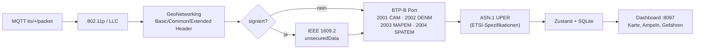

# 9 – Lokaler Decoder & Dashboard

Läuft als Container auf dem Heimserver, liest `its/+/packet` und dekodiert **CAM, DENM, SPATEM, MAPEM**.


<details><summary>Mermaid-Quelltext</summary>



</details>


## Start
```bash
docker compose up -d --build
# Dashboard: http://<server>:8097     Broker (LAN): <server>:1885
```
ASN.1-Dateien werden beim Build von ETSI-Forge/Vanetza geholt (`decoder/fetch_asn.sh`): CAM v1.4.1, DENM v1.3.1, SPATEM/MAPEM v2.2.1 mit ISO-TS-19091-DSRC.

## Beispielansicht (Demo-Daten)


*Alle Werte sind **erfunden** (Demo-Modus `decoder/tools_demo.py`, Karte Münchner Olympiapark); echte Funkdaten liegen noch nicht vor. Der gelbe Balken erscheint automatisch, solange Demo-Daten im Dashboard sind. Im Bild stehen keine Zugangsdaten, Adressen oder Hostnamen.*

## Was das Dashboard zeigt
Karte mit Fahrzeugen (CAM), Kreuzungen (MAPEM) und Gefahren (DENM); je Kreuzung die Signalgruppen-Zustände (SPATEM); Paketrate und Zähler je Typ (inkl. „undecoded", „secured", ASN.1-Fehler); die letzten 30 Ereignisse. Zusätzlich wird aus dem GeoNetworking-Header jeder Sender-Position (auch ohne CAM) übernommen.

## Home Assistant
Der Decoder meldet sich per MQTT-Discovery am Broker von Home Assistant an (Gerät „Ice-Traffic-Data"): Pakete/min, sichtbare Fahrzeuge, aktive Gefahrenmeldungen, Kreuzungen mit Ampeldaten, bekannte Kreuzungen, Frames gesamt, nicht dekodiert, „Letztes Paket vor", „Empfänger online" und die letzte Gefahrenmeldung (Details als Attribute). Zugangsdaten stehen in einer lokalen `.env` (nicht im Repo; Vorlage: `HA_MQTT_*` in `docker-compose.yml`). Aktualisierung alle 10 s; Sensoren gehen auf „nicht verfügbar", wenn der Decoder stoppt.

Hinweis: Dass HA die Entities tatsächlich anlegt, wurde nur über die retained Discovery-Meldungen (10 Stück im Broker) geprüft, nicht in der HA-Oberfläche.

## Datenschutz
Alles bleibt lokal. SQLite (`msgs`) hält Rohdekodierungen 7 Tage (`retention`), danach Löschung. CAM-Daten fremder Fahrzeuge sind pseudonymisiert, aber ortsbezogen – nicht weitergeben.

## Teststand – ehrlich
- ✅ Unit-Tests (`decoder/tests`): synthetisch kodierte CAM/SPATEM → Frame → Dekodierung → Zusammenfassung; IEEE-1609.2-Hülle; defekte Frames. Ende-zu-Ende über Docker+MQTT mit synthetischem CAM.
- ❌ **Nicht mit echten Funkdaten geprüft.** Offene Risiken: (a) Aufbau der signierten Pakete (Position von Common/Extended Header relativ zur 1609.2-Hülle), (b) SPATEM/MAPEM-Versionen in Deutschland (v1.3.x vs. 2.x, regionale Erweiterungen), (c) CAM-Version im Feld. Beim ersten Mitschnitt: Hexdump + Wireshark vergleichen; Zähler `undecoded` / `decode_error_*` zeigen Abweichungen.
- Der ITS5/ITS6-Header (Zeitstempel, ab ITS6 auch RSSI, Rauschpegel und Rate) wird von der Bridge entfernt; die MQTT-Nutzlast ist unverändert das reine 802.11-Paket, der Decoder bekommt **keine RSSI**. Die RSSI steht im Mitschnitt der GPS-LoRa (`frames.bin`, `log.csv`).

## Auto-Knoten im Dashboard (LoRa)
Das Dashboard (`/`) zeigt zusätzlich den Auto-Knoten, der per LoRaWAN-Uplink (alle 60 s) gemeldet wird. Der Decoder speichert jeden Uplink in der Tabelle `car` der SQLite-Datenbank (Aufbewahrung wie `msgs`, 7 Tage) und liefert `car` in `/api/state`:

- **Beacon (Lebenszeichen):** Der 60-s-Uplink ist das Beacon. Status *online* bis 2,5 Intervalle, *überfällig* bis 10 Intervalle, danach *offline*. Verpasste Uplinks werden aus Lücken im Frame-Zähler berechnet (Zählerrücksprung bei Neustart zählt nicht).
- **Standort:** letzter GPS-Fix (Link zu Google Maps), Fahrtspur der letzten 24 h als Linie auf der Karte (ein Punkt pro Minute).
- **Gesendet:** Anzahl Uplinks und Nutzlast-Bytes. **Empfangen:** ITS-G5-Pakete nach Typ, Sniffer-Fehler/Unicast/verworfen, nicht gespeicherte Pakete; jeweils Summen der Intervalle.
- Es wird nichts auf 5,9 GHz gesendet; „Beacon“ meint nur das LoRa-Lebenszeichen.
- **Datenschutz:** Die Seite zeigt die Live-Position. Der Zugriff von außen hängt am Schutz vor its.mpauli.de (nicht hier geprüft). Rohdaten und Spuren gehören nicht ins Repo.
