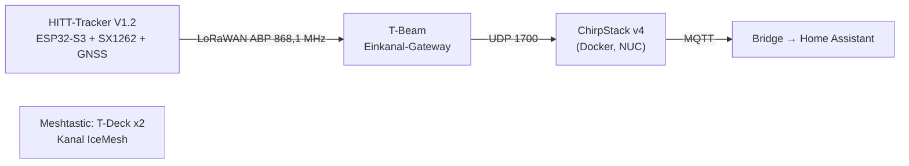
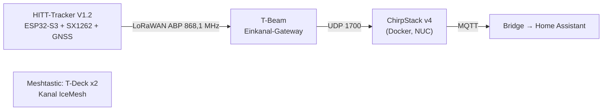
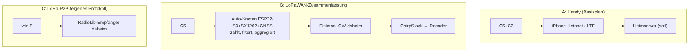
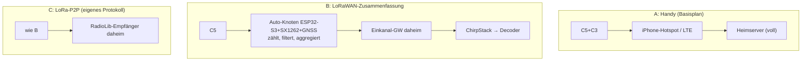
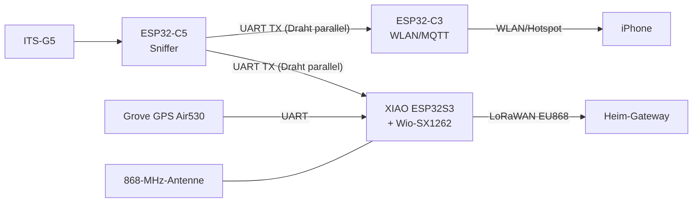
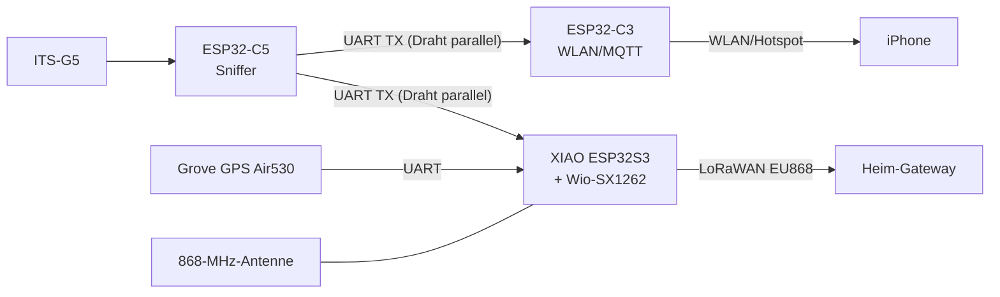

# 10 – Analyse: Daten per LoRa(WAN) vom Auto nach Hause

> Reine Analyse, **nichts davon ist gebaut oder getestet**. Zahlen sind Näherungswerte nach LoRaWAN-Regionalparametern EU868 und müssen vor einer Umsetzung geprüft werden.

## Was zu Hause schon steht (aus dem Bestand)

Mermaid-Quelltext

- **Empfang daheim:** ein LoRaWAN-Einkanal-Gateway (T-Beam, SX1276) liefert an ChirpStack; Ende-zu-Ende mit dem Tracker bereits verifiziert (Geigerzähler-Projekt, ABP, DR3).
- **Sender mit GNSS:** der HITT-Tracker hat SX1262, GNSS und ESP32-S3 – prinzipiell ein fertiger „Auto-Knoten".
- **Meshtastic:** zwei T-Decks (mobil) – das Gateway-Board ist aber für LoRaWAN umgeflasht, die Meshtastic-Gateway-Funktion daher aus.

## Grundproblem: Datenmenge und Duty-Cycle
| Größe | Wert (ca.) |
|---|---|
| ITS-G5-Rohdaten | Dutzende bis Hunderte Pakete/s à 100–800 B |
| LoRaWAN EU868 Nutzlast | SF12–SF10: max. 51 B · SF9: 115 B · SF8/SF7: 242 B |
| Sendezeit | SF7 ≈ 0,1 s · SF9 ≈ 0,3–0,4 s · SF12 > 1 s je Uplink |
| Duty-Cycle (Standardkanäle 868,1–868,5) | 1 % → bei SF9 ca. alle 40 s ein Uplink |

**Folge:** Rohpakete oder gar volle SPATEM/MAPEM-Ströme passen nicht durch LoRa. Das Auto müsste **vorverarbeiten** und nur Zusammenfassungen senden.

## Architekturvarianten

Mermaid-Quelltext

| | A Handy | B LoRaWAN | C P2P |
|---|---|---|---|
| Datenmenge | voll | nur Zusammenfassung | nur Zusammenfassung |
| Reichweite | überall mit Mobilfunk | Stadt ca. 1–3 km zum Heim-GW (Schätzung), weiter nur mit hohem Standort oder fremden Gateways | ähnlich, ohne Protokoll-Overhead |
| Abhängigkeit | Handy, Mobilfunk | nur eigenes Funknetz | nur eigenes Funknetz |
| Aufwand | gering | mittel (Firmware-Aggregation + Nutzlast-Decoder in ChirpStack) | mittel–hoch |
| Passt zum Bestand | – | ✅ ChirpStack+GW laufen | ❌ neuer Empfänger |

**Einordnung:** LoRa ist hier **kein Ersatz** für Variante A, sondern ein *Zusatzkanal für Zusammenfassungen* (z. B. „SPATEM an Kreuzung 1001 gesehen", Paketzähler, Fahrzeugposition). In München ist der Heim-Standort Ottobrunn ohnehin oft außer Reichweite des Einkanal-Gateways; öffentliche Netze (z. B. The Things Network) würden die Daten zu einem Cloud-Anbieter leiten und widersprechen dem Ziel „alles lokal".

## Ursprünglicher Nutzlast-Entwurf (ersetzt durch v1 oben)
| Byte | Inhalt |
|---|---|
| 0 | Version/Flags |
| 1–8 | Auto-Position lat/lon (int32 je 1e-5°) + Fix-Qualität |
| 9–12 | Zähler seit letztem Uplink: CAM, DENM, SPATEM, MAPEM (je 1 B) |
| 13–16 | Kreuzungs-ID (strengste Nähe) |
| 17–… | je Signalgruppe 1 B (Zustand) für bis zu ~10 Gruppen |
| … | neue DENM: Cause/SubCause + Position (≈ 10 B) |

Die UPER-Dekodierung von SPATEM/MAPEM auf dem ESP32 ist aufwendig; einfacher ist eine **Vorfilterung nach BTP-Port und Kreuzungs-ID** und Übertragung ausgewählter Rohbytes, falls sie in 51–115 B passen.

## Weitere Optionen
- **Sub-Band 869,4–869,65 MHz:** nach EU-Regeln höherer erlaubter Duty-Cycle (nach meinem Kenntnisstand 10 %, bis 500 mW ERP) – für P2P/Telemetrie attraktiv, aber nicht in Standard-LoRaWAN-Kanalplänen; **Rechtslage vor Nutzung prüfen**.
- **Meshtastic (T-Deck):** Textnachrichten bis ca. 200 B über den IceMesh-Kanal; langsame Presets (LongFast) und fremde Knoten als Relais, dafür keine eigene Infrastruktur. Das Gateway-Board müsste dafür wieder Meshtastic-Gateway sein.
- **Zwei Gateways:** ein echtes 8-Kanal-Gateway statt Einkanal würde OTAA und Adaptive Data Rate erlauben.

## Empfehlung
1. Zuerst Variante A bauen und messen (Pakete/min, welche Typen, wo).
2. Erst wenn klar ist, *welche* Daten sich lohnen (z. B. SPATEM an bestimmten Kreuzungen), Variante B als zweiten Uplink mit dem Tracker prototypen.
3. Bis dahin offen: Reichweitentest Auto → Heim-Gateway mit dem Tracker (60-s-ABP-Test, RSSI/SNR in ChirpStack auswerten).

## Auto-Knoten (Hardware, Bestellung in [12](12-bestellung.md))

Mermaid-Quelltext

- Der C5-TX-Draht kann zwei Empfänger speisen (3,3-V-Logik, nur Mithören) – C3 und S3 sehen dieselben ITS5-Frames.
- Der XIAO ESP32S3 filtert nach BTP-Port und Kreuzungs-ID, zählt Pakete, liest das GNSS und sendet alle ~60 s (und bei neuem DENM) eine Zusammenfassung.
- **Firmware-Entwurf vorhanden:** [`firmware/lora-car-node`](https://github.com/icepaule/Ice-Traffic-Data/tree/main/firmware/lora-car-node) (RadioLib, LoRaWAN ABP, 868,1 MHz, DR3 wie beim IceGeiger-Tracker). Kompiliert, PC-Tests bestanden (inkl. Abgleich der Nutzlast mit dem Simulator), Signierte Pakete (IEEE 1609.2) werden ausgepackt und nach Typ gezählt, ohne Signaturprüfung (Testvektoren aus dem Decoder-Schema). **Nicht auf Hardware getestet**. Die Kette dahinter wurde mit einem simulierten, gültig signierten Uplink bis in Home Assistant geprüft.
- **ChirpStack:** Anwendung `IceTraffic` und Gerät `ice-car` sind angelegt (`scripts/provision-chirpstack.py`); der Payload-Decoder liegt in `chirpstack-codec.js`. Der bestehende IceGeiger-Bridge-Dienst ignoriert Uplinks anderer Anwendungen.
- **Home Assistant:** Der Decoder-Dienst legt für den Auto-Knoten Entities an (Zähler je Typ, Geschwindigkeit, Satelliten, RSSI/SNR, letzter Uplink, `device_tracker` „Auto").

### Nutzlast v1 (25 Byte, Big Endian)
| Byte | Inhalt |
|---|---|
| 0 | Version (1) |
| 1 | Flags: Bit0 GNSS-Fix, Bit1 neue DENM, Bit2 C5-Brücke aktiv |
| 2–5 / 6–9 | Breite / Länge (int32, 1e-6°) |
| 10 / 11 | Geschwindigkeit km/h / Satelliten |
| 12–23 | Zähler CAM, DENM, SPATEM, MAPEM, signiert (= 1609.2-Layout nicht erkannt), sonstige (je uint16, seit letztem Uplink) |
| 24 | Betriebszeit in 10-Minuten-Schritten |
- Die Antenne gehört senkrecht an Scheibe/Armaturenbrett, nicht neben Metall; das GNSS braucht freie Sicht nach oben.
