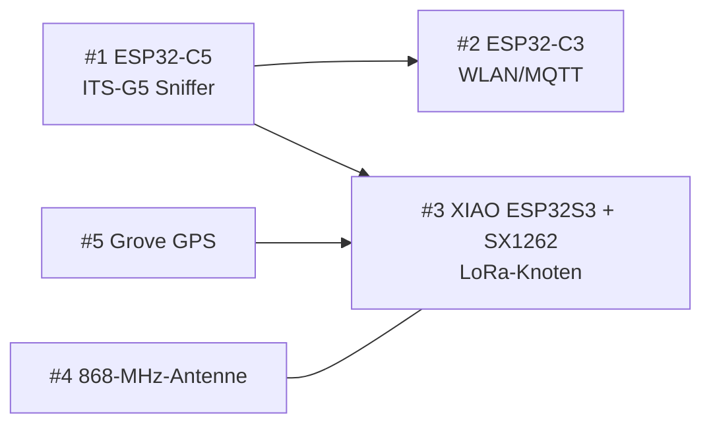

# 12 – Stückliste (BOM) & Bestellung DigiKey

Bestellt am 01.11.2026 bei DigiKey.de. Menge je Position **2** (Aufbau im Auto + Ersatz bzw. zweite Station, z. B. fester Empfänger zu Hause).

## Bestellung (laut Warenkorb)

| # | DigiKey-Nr. | Hersteller / Typ | Funktion | Menge | Stückpreis | Summe |
|---|---|---|---|---|---|---|
| 1 | 1965-ESP32-C5-DEVKITC-1-N8R8-ND | Espressif ESP32-C5-DevKitC-1-N8R8 | ITS-G5-Sniffer (PCB-Antenne) | 2 | 15,00 | 30,00 |
| 2 | 1965-ESP32-C3-DEVKITM-1-N4X-ND | Espressif ESP32-C3-DevKitM-1-N4X | WLAN/MQTT-Brücke | 2 | 8,00 | 16,00 |
| 3 | 1597-102010611-ND | Seeed 102010611, XIAO ESP32S3 + Wio-SX1262 | LoRa-Auto-Knoten | 2 | 10,90 | 21,80 |
| 4 | ANT-868-PW-QW-UFL-ND | TE Connectivity Linx ANT-868-PW-QW-UFL | 868-MHz-Antenne (U.FL, 216 mm Kabel) | 2 | 12,40 | 24,80 |
| 5 | 1597-109020022-ND | Seeed 109020022, Grove GPS (Air530) | GNSS für den Auto-Knoten | 2 | 11,00 | 22,00 |
| | | | | | **Summe** | **114,60** |

Hinweis: Der Warenkorb zeigt die Summen mit „$"-Zeichen; die Stückpreise entsprechen den EUR-Preisen der DigiKey.de-Seiten. Die Währung bitte mit der Rechnung abgleichen.

## Teilebilder

Die Bilder werden direkt von DigiKey geladen (nicht im Repo gespeichert; Rechte liegen bei den Herstellern bzw. DigiKey). Fällt ein Link später weg, bleibt die Tabelle darüber vollständig.

| # | Teil | Bild |
|---|---|---|
| 1 | ESP32-C5-DevKitC-1-N8R8 |  |
| 2 | ESP32-C3-DevKitM-1-N4X |  |
| 3 | XIAO ESP32S3 + Wio-SX1262 |  |
| 4 | Linx ANT-868-PW-QW-UFL |  |
| 5 | Grove GPS (Air530) |  |

Produktseiten: [LoRa-Kit (1597-102010611-ND)](https://www.digikey.de/de/products/detail/seeed-technology-co-ltd/102010611/25835813) · [C5-DevKit (digikey.com)](https://www.digikey.com/en/products/detail/espressif-systems/ESP32-C5-DEVKITC-1-N8R8/28718162). Für die übrigen Teile konnte ich keine Produktseiten-URL ermitteln; die DigiKey-Nummer in die Suche eingeben.

## Funktionsweise im Aufbau

Mermaid-Quelltext

## Noch nicht bestellt (Kleinteile, lokal besorgen)
- Jumperkabel (Dupont), ca. 10 Stück
- 2 USB-Datenkabel (USB-C für C5 und XIAO, Micro-USB für C3)
- KFZ-USB-Netzteil 5 V, mindestens 2 A
- ggf. Grove-Kabel, falls dem GPS keines beiliegt
- Gehäuse (3D-Druck) und Befestigung

## Bewusst nicht bestellt
- Seeed-Antenne 318020389: für 902–928 MHz, nicht auf EU868 abgestimmt.
- Seeed-Antenne 318020269 (868 MHz): zum Recherchezeitpunkt nicht lieferbar.
- Molex 2119960100 (ITS-G5, 5,9 GHz): das C5-Board hat keinen U.FL-Anschluss, siehe [11](11-antennen.md).

## Zu klären nach Lieferung
- Liegen dem LoRa-Kit Antennen bei? (Seeed-Wiki: ja, DigiKey-Seite listet nur „Platine(n)".)
- Liegt dem Grove-GPS ein Grove-Kabel bei? Sonst Jumper.
- UART-Pins am XIAO ESP32S3 (D6/D7 = GPIO43/44?) und Belegung unter dem Wio-Aufsatz gegen das Datenblatt prüfen.
- C5: UART-Pins (TX = GPIO11) gegen Schaltplan/Multimeter prüfen, siehe [03](03-verdrahtung.md).
