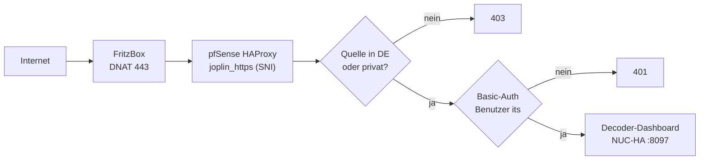

# 13 – Dashboard öffentlich: https://its.mpauli.de (Vorlage: THW-Barbeleg)

Das Dashboard ([09](09-decoder.md)) ist nach demselben Muster wie `invoice.mpauli.de` (THW-Barbeleg) veröffentlicht: Hetzner-DNS, Let's-Encrypt-Zertifikat, pfSense-HAProxy als TLS-Edge, drei Schutzschichten.

| Schicht | Umsetzung |
|---|---|
| 1. Nur Deutschland | HAProxy-Quell-ACL aus derselben CIDR-Liste wie beim Barbeleg (ipdeny.com, monatlich erneuern); private Netze sind ausgenommen |
| 2. Front-door-Login | HTTP-Basic-Auth, Benutzer `its`; Passwort nur auf dem Server unter `$ITS_DEPLOY/secrets/web.pass` |
| 3. Anwendung | Das Dashboard selbst hat keinen eigenen Login |

## Schritte (wie beim Barbeleg)
1. **DNS/DDNS:** `its` steht im Hetzner-DDNS-Skript (`HOSTS=`) – siehe [08](08-heimserver.md).
2. **Zertifikat:** `acme.sh --issue --dns dns_mphcloud -d its.mpauli.de --server letsencrypt` (Custom-Hook, Standard-Plugins schreiben in die falsche Zone).
3. **HAProxy-Veröffentlichung:** `/opt/sso-publish.sh its its.mpauli.de 10.10.0.100 8097 no` importiert das Zertifikat, legt Pool, ACL und Action an und lädt HAProxy **validiert** neu.
4. **Schutzschichten:** im Pool `its_backend` die Advanced-Backend-Zeilen (DE-ACL, interne Netze, Basic-Auth) setzen – gleiche Zeilen wie beim Barbeleg, nur mit eigenen ACL-Namen und eigenem Passwort. Vorher Sicherung der pfSense-Config.
5. **Split-DNS:** `/opt/sso-dns-sync.sh` biegt `its.mpauli.de` intern automatisch auf die HAProxy-Adresse (192.168.178.154), weil der A-Record auf die Heim-IP zeigt.

## Prüfung (01.11.2026)
| Test | Ergebnis |
|---|---|
| intern, ohne Login | 401 |
| intern, falsches Passwort | 401 |
| intern, richtiges Passwort (`/` und `/api/state`) | 200 |
| extern (Hetzner-Server in DE über die öffentliche IP), ohne / mit Login | 401 / 200 |
| Quelle außerhalb Deutschlands | **nicht getestet** (kein Testhost außerhalb DE) |

## Wichtig: derselbe Name, zwei Dienste
`its.mpauli.de` dient für **HTTPS (443, Dashboard)** und für **MQTT (18883, Auto)**. Durch das Split-DNS landet ein Gerät im LAN bei `its.mpauli.de:18883` auf der pfSense-Adresse, wo es keine LAN-seitige Weiterleitung gibt. Im Heimnetz die Bridge darum auf `<NUC-IP>:1885` (ohne TLS) stellen. Im Auto über den Hotspot ist der Name öffentlich und funktioniert.

## Nachziehen/Wartung
- DE-Liste auf der pfSense erneuern (siehe Barbeleg-Doku: `fetch` von ipdeny.com, danach validierter HAProxy-Reload).
- Zertifikat erneuert acme.sh automatisch; für den Broker kopiert der `--reloadcmd` aus `scripts/setup-broker.sh` das neue Zertifikat und startet den Broker neu. Für HAProxy muss das erneuerte Zertifikat erneut importiert werden (wie bei den übrigen Hosts, siehe `/opt/sso-cert-deploy.sh`).
- Optional: MQTT-Port 18883 ebenfalls auf DE-Quellen beschränken (pf-Alias aus derselben Liste).
