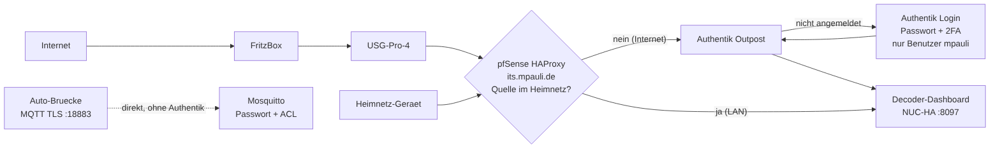
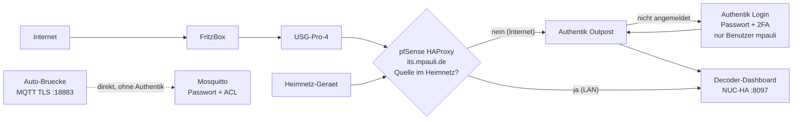

# 13 – Dashboard öffentlich: https://its.mpauli.de (hinter Authentik SSO + 2FA)

Das Dashboard ([09](09-decoder.md)) ist nach demselben Muster wie `invoice.mpauli.de` (THW-Barbeleg) veröffentlicht: Hetzner-DNS, Let's-Encrypt-Zertifikat, pfSense-HAProxy als TLS-Edge, drei Schutzschichten.

Mermaid-Quelltext

| Schicht | Umsetzung |
|---|---|
| 1. Authentik (SSO + 2FA) | Wie bei allen aus dem Internet erreichbaren Diensten: HAProxy leitet an den Authentik-Outpost; nicht angemeldete Besucher werden zum Login (`auth.mpauli.de`, Passwort + 2. Faktor) umgeleitet |
| 2. Nur `mpauli` | Zugriffsregel an der Anwendung `its`: nur der Benutzer `mpauli` (Policy-Binding, Modus „any") |
| 3. Heimnetz direkt | Zugriffe aus dem Heimnetz (private Quelladresse, nicht die USG) gehen am HAProxy per Quell-IP-Weiche **direkt** zum Dashboard, ohne Authentik – wie bei Wazuh, Flightradar und Kroatien |
| 4. Anwendung | Das Dashboard selbst hat keinen eigenen Login |

**Ausnahme MQTT:** Die TLS-Verbindung der Auto-Brücke (`its.mpauli.de:18883`) läuft **direkt** am Broker vorbei an Authentik – sie ist durch TLS, Passwort und Schreib-ACL gesichert ([08](08-heimserver.md)).

## Schritte
1. **DNS/DDNS + Zertifikat:** `its` steht im Hetzner-DDNS-Skript; das Let's-Encrypt-Zertifikat wird per `acme.sh --dns dns_mphcloud` ausgestellt.
2. **SSO-Veröffentlichung:** `/opt/sso-gate.sh its its.mpauli.de http://10.10.0.100:8097` legt Proxy-Provider und Anwendung in Authentik an, hängt sie an den Outpost und veröffentlicht am HAProxy (Backend = Outpost :9000).
3. **Zugriff auf `mpauli` beschränken:** Policy-Binding (Benutzer `mpauli`, Reihenfolge 0) an der Anwendung, `policy_engine_mode = any` – wie bei ArgoCD, CheckMK u. a.
4. **LAN-Weiche:** Pool `its_direct_backend` (10.10.0.100:8097) und Regel `use_backend its_direct_backend if its_host guest_lan !guest_fritzbox` **vor** der Outpost-Regel im HAProxy-Frontend. Die ACLs `guest_lan` (10/8, 172.16/12, 192.168/16) und `guest_fritzbox` (192.168.178.1 = USG, Fail-safe) existieren bereits.
5. **Split-DNS:** `/opt/sso-dns-sync.sh` biegt `its.mpauli.de` intern auf die HAProxy-Adresse (192.168.178.154) – dort greift dieselbe Authentik-Regel.
6. Vorher war das Dashboard mit Basic-Auth und DE-Filter direkt veröffentlicht (Muster THW-Barbeleg); diese Direktveröffentlichung wurde entfernt (pfSense-Sicherung vorher).

## Prüfung (01.11.2026)
| Test | Ergebnis |
|---|---|
| **extern** (Hetzner-Server, öffentliche Quell-IP), `/` und `/api/state` ohne Anmeldung | 302 → Authentik-Login |
| **intern** (Heimnetz-Quelle), `/` und `/api/state` | 200, direkt, ohne Anmeldung |
| Basic-Auth mit alten Zugangsdaten von außen | 401 (kein Zugriff mehr) |
| MQTT über TLS (`:18883`) von außen | direkt erreichbar, Anmeldung ok |
| Vollständiger Browser-Login mit 2. Faktor | **nicht automatisiert getestet** – bitte einmal im Browser prüfen |

## Wichtig: derselbe Name, zwei Dienste
`its.mpauli.de` dient für **HTTPS (443, Dashboard)** und für **MQTT (18883, Auto)**. Durch das Split-DNS landet ein Gerät im LAN bei `its.mpauli.de:18883` auf der pfSense-Adresse, wo es keine LAN-seitige Weiterleitung gibt. Im Heimnetz die Bridge darum auf `<NUC-IP>:1885` (ohne TLS) stellen. Im Auto über den Hotspot ist der Name öffentlich und funktioniert.

## Wartung
- Zertifikat erneuert acme.sh automatisch; für HAProxy muss das erneuerte Zertifikat erneut importiert werden (wie bei den übrigen Hosts, `/opt/sso-cert-deploy.sh`), für den Broker kopiert der `--reloadcmd` aus `scripts/setup-broker.sh` es.
- Weitere Benutzer später: Policy-Binding in Authentik ergänzen.

> Lehre aus dem Kroatien-Projekt: Eine Quell-IP-Weiche ist nur so vertrauenswürdig wie die Netzstruktur davor. Hier kommen Internet-Zugriffe mit ihrer echten öffentlichen Adresse an (am Test vom Hetzner-Server bestätigt); Anfragen, die über die USG-Adresse laufen, werden bewusst nicht als „Heimnetz" gewertet.
