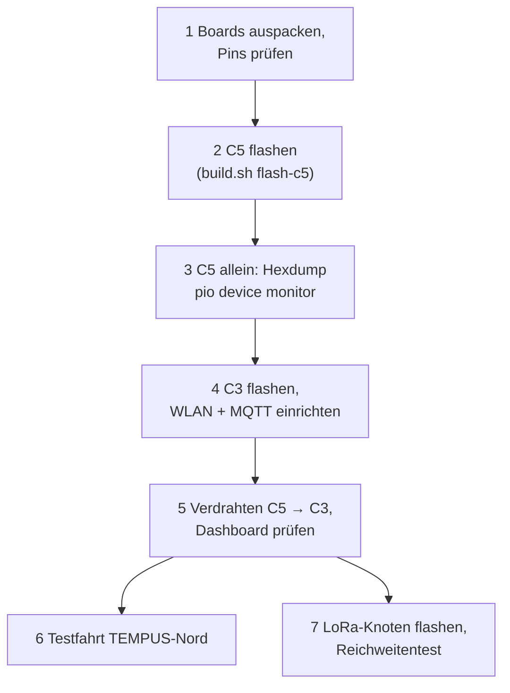

# 14 – Inbetriebnahme: was schon vorbereitet ist und was am Liefertag folgt

## Bereits vorbereitet (ohne Hardware)
| Bereich | Stand |
|---|---|
| Firmware C5 + C3 | gebaut, Patch für DevKitM-1 ([04](04-firmware.md)); `firmware/build.sh` |
| Firmware LoRa-Knoten | Entwurf, kompiliert, PC-Tests bestanden ([`firmware/lora-car-node`](https://github.com/icepaule/Ice-Traffic-Data/tree/main/firmware/lora-car-node)) |
| Decoder + Dashboard | läuft; Tests mit synthetischen Daten; **Demo-Modus** (`decoder/tools_demo.py`) |
| Home Assistant | Gerät „Ice-Traffic-Data" per MQTT-Discovery; Auto-Knoten-Entities bereit |
| MQTT öffentlich | `its.mpauli.de:18883` von außen getestet ([08](08-heimserver.md)) |
| Dashboard öffentlich | `https://its.mpauli.de` (Internet: Authentik SSO + 2FA, nur `mpauli`; Heimnetz direkt) ([13](13-dashboard-veroeffentlichen.md)) |
| ChirpStack | Anwendung `IceTraffic`, Gerät `ice-car` (ABP) angelegt; Schlüssel nur lokal |
| LoRa-Kette hinter dem Funkmodul | **Ende-zu-Ende ohne Hardware getestet** (simulierter Uplink → ChirpStack → Decoder → Home Assistant), siehe [Firmware-README](https://github.com/icepaule/Ice-Traffic-Data/tree/main/firmware/lora-car-node) |
| Dokumentation | Mermaid als PNG (funktioniert überall), GitHub Pages |

## Demo ohne Hardware
```bash
docker compose up -d
ITS_ASN_DIR=decoder/asn PYTHONPATH=decoder python3 decoder/tools_demo.py   # erfundene Daten, Strg+C beendet
# Dashboard: http://<server>:8097   – Daten danach wieder löschen (SQLite-Tabelle msgs)
```

## Liefertag – Reihenfolge


<details><summary>Mermaid-Quelltext</summary>



</details>

1. **Pins prüfen** (C5 TX = GPIO11? C3 GPIO4? XIAO GPIO44/6/5?), Antennen am XIAO anstecken **bevor** gesendet wird.
2. **C5 flashen:** `cd firmware && ./build.sh flash-c5 /dev/ttyACM0`. LED blinkt jede Sekunde. Mitschnitt: `pio device monitor` → Hexdump → `text2pcap -l 105` → Wireshark. **Das ist der wichtigste Test für den Decoder** (signierte Pakete? Versionen?).
3. **C3 flashen:** `./build.sh flash-c3 /dev/ttyUSB0`, dann `wifi <ssid> <pw>`, in der Weboberfläche MQTT eintragen (**nach jedem `flash-c3` neu, das Dateisystem-Flash löscht die MQTT-Einstellungen**) (zu Hause `mqtt://<NUC>:1885`, unterwegs `mqtts://its.mpauli.de:18883` mit Benutzer `car`).
4. **Dashboard** beobachten: `frames`, `undecoded`, `secured`, `decode_error_*`.
5. **LoRa-Knoten:** `python3 scripts/provision-chirpstack.py` (falls `secrets.h` fehlt), `pio run -t upload`, Seriell-Log prüfen, in ChirpStack den Uplink von `ice-car` sehen.
6. **Reichweite:** mit dem Auto-Knoten Strecken abfahren, RSSI/SNR in Home Assistant bzw. ChirpStack auswerten.

## Was wir am Liefertag lernen müssen (offene Annahmen)
- Sind die empfangenen Pakete überwiegend signiert, und stimmt der Aufbau (Common Header innerhalb der 1609.2-Hülle)?
- Welche SPATEM/MAPEM-Versionen senden die Anlagen tatsächlich?
- Empfängt der C5 mit Platinenantenne im Auto genug (Pakete/min)?
- Reichweite des Einkanal-Gateways bis zur Straße.
