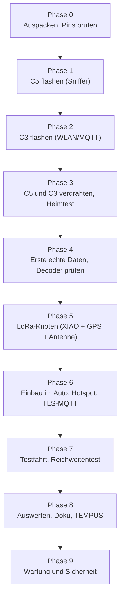
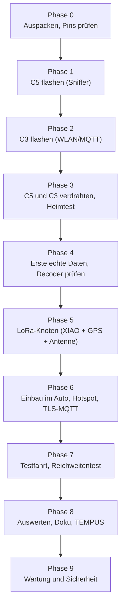

# 17 – Umsetzungsplan (Schritt für Schritt)

Dieser Plan führt von der Lieferung bis zur Auswertung. Jeder Schritt nennt die **beteiligten Teile** (Nummern aus der [Stückliste](12-bestellung.md)), eine **Kurzerklärung** und ein **Fertig-Kriterium**. Details und Abhaken: [16 – ToDo nach Lieferung](16-todo-nach-lieferung.md).

**Teile-Kürzel**

| Kürzel | Teil | Aufgabe |
|---|---|---|
| **#1 C5** | Espressif ESP32-C5-DevKitC-1-N8R8 | empfängt ITS-G5 (802.11p, 5,9 GHz) im Mithör-Modus |
| **#2 C3** | Espressif ESP32-C3-DevKitM-1-N4X | schickt die Daten per WLAN/MQTT zum Heimserver |
| **#3 XIAO** | Seeed XIAO ESP32S3 + Wio-SX1262 (102010611) | LoRa-Auto-Knoten, sendet eine Zusammenfassung per LoRaWAN |
| **#4 ANT** | TE Linx ANT-868-PW-QW-UFL | 868-MHz-Antenne für #3 (U.FL) |
| **#5 GPS** | Seeed Grove GPS Air530 (109020022) | Position und Geschwindigkeit für #3 |
| Kleinteile | Jumperkabel (Dupont), USB-Datenkabel (USB-C ×2, Micro-USB), KFZ-Netzteil 5 V ≥ 2 A, ggf. Grove-Kabel | Verdrahtung und Strom |

Mermaid-Quelltext

> **Stand 08.11.2026:** Phasen 0–3 und 5 sind am Schreibtisch abgeschlossen, Phase 4 (echte Daten) und 6–9 stehen aus. Gerätenamen und Erkenntnisse: [18](18-schreibtischtest-und-mitschnitt.md). Kürzel im Gespräch: **Traffik-Sniffer** = #1 C5, **Trafik-CPU** = #2 C3, **GPS-LoRa** = #3 XIAO.

> **Grundregel:** Immer nur **ein** Board einstecken, dann erkennt man den neuen USB-Port (`ls /dev/ttyACM* /dev/ttyUSB*` vorher/nachher). So wird nie das falsche Gerät beschrieben.

## Phase 0 – Auspacken und Pins prüfen
| Schritt | Teile | Erklärung | Fertig, wenn |
|---|---|---|---|
| 0.1 Vollständigkeit | #1–#5 je 2× | Lieferung gegen die Stückliste prüfen. | alles vorhanden |
| 0.2 Beilagen | #3, #5 | Liegen dem LoRa-Kit Antennen bei, dem GPS ein Grove-Kabel? | notiert |
| 0.3 Kleinteile | Jumper, USB-Kabel, KFZ-Netzteil | Datenkabel (nicht nur Ladekabel!) sind Pflicht. | vorhanden |
| 0.4 Pins prüfen | #1, #2, #3 | C5 TX = GPIO11, C3 RX = GPIO4, XIAO RX = GPIO44, GPS an GPIO6/5 gegen Datenblatt/Beschriftung prüfen ([03](03-verdrahtung.md)). | Abweichungen in Doku und Firmware eingetragen |

## Phase 1 – ITS-G5-Sniffer (C5) flashen
| Schritt | Teile | Erklärung | Fertig, wenn |
|---|---|---|---|
| 1.1 Bauen | Server | `cd firmware && ./build.sh` baut beide Firmwares (Toolchain liegt im Cache). | Build ohne Fehler |
| 1.2 Flashen | #1 C5, USB-C-Kabel | Nur C5 einstecken, Port erkennen, `./build.sh flash-c5 <Port>`. | Flash erfolgreich |
| 1.3 Lebenszeichen | #1 C5 | LED blinkt jede Sekunde; `pio device monitor` zeigt Hexdumps, sobald Pakete ankommen. | LED blinkt |

## Phase 2 – WLAN/MQTT-Brücke (C3) flashen
| Schritt | Teile | Erklärung | Fertig, wenn |
|---|---|---|---|
| 2.1 Flashen | #2 C3, Micro-USB-Kabel | Nur C3 einstecken, `./build.sh flash-c3 <Port>`. | Flash erfolgreich |
| 2.2 WLAN | #2 C3 | Über die serielle Konsole `wifi <SSID> <Passwort>` setzen. | C3 hängt im Heim-WLAN |
| 2.3 MQTT (zu Hause) | #2 C3 | Weboberfläche des C3 öffnen, MQTT auf den Broker im Heimnetz (Port 1885, ohne TLS) stellen. | Status „verbunden" |

## Phase 3 – Verdrahten und Heimtest
| Schritt | Teile | Erklärung | Fertig, wenn |
|---|---|---|---|
| 3.1 Verdrahten | #1 C5, #2 C3, Jumper | GND↔GND, 5 V, C5 TX (GPIO11) → C3 GPIO4. Beide Boards 3,3-V-Logik, kein Pegelwandler nötig. | Boards starten gemeinsam |
| 3.2 Dashboard | Server | Im Dashboard erscheinen `frames` und der Empfänger als „online" (Frames nur, wenn in der Nähe gesendet wird). | Empfänger online |
| 3.3 Antennenposition | #1 C5 (PCB-Antenne) | Fensterbank gegen Armaturenbrett vergleichen; das Board hat nur eine PCB-Antenne ([11](11-antennen.md)). | Position gewählt |

## Phase 4 – Erste echte Daten (wichtigster Decoder-Test)
| Schritt | Teile | Erklärung | Fertig, wenn |
|---|---|---|---|
| 4.1 Mitschnitt | #1 C5 | Hexdump mitschneiden, mit `text2pcap -l 105` in eine pcap wandeln, in Wireshark ansehen. | pcap vorhanden |
| 4.2 Zähler lesen | Server | Dashboard-Zähler `undecoded`, `secured`, `decode_error_*` beobachten. | Werte notiert |
| 4.3 Annahmen prüfen | Server | Sind die Pakete signiert (IEEE 1609.2)? Stimmen Header-Layout und SPATEM/MAPEM-Version? | Abweichungen dokumentiert |
| 4.4 Decoder anpassen | Server | `decoder/its_decoder/gn.py` und `firmware/lora-car-node/src/its_parse.h` korrigieren; Mitschnitt als Testfall ablegen (ohne personenbezogene Daten). | Tests grün |

## Phase 5 – LoRa-Auto-Knoten
| Schritt | Teile | Erklärung | Fertig, wenn |
|---|---|---|---|
| 5.1 Antenne zuerst | #3 XIAO, #4 ANT | Antenne an den U.FL-Anschluss des Wio-SX1262 stecken, **bevor** gesendet wird (sonst kann der Sender Schaden nehmen). | Antenne steckt |
| 5.2 GPS | #5 GPS, Grove-Kabel | GPS an GPIO6 (RX) / GPIO5 (TX) des XIAO. | NMEA-Daten im Log |
| 5.3 Schlüssel | Server | `secrets.h` ist lokal vorhanden (nicht im Repo); sonst `scripts/provision-chirpstack.py` erneut laufen lassen. | Datei vorhanden |
| 5.4 Flashen | #3 XIAO, USB-C-Kabel | `cd firmware/lora-car-node && pio run -t upload`; Log: `radio.begin state=0`, `activateABP`. | Uplinks im Seriell-Log |
| 5.5 Empfang | Server | ChirpStack zeigt Uplinks von `ice-car`, Home Assistant füllt die Auto-Knoten-Entities. | Werte in HA |
| 5.6 Fehlersuche | Server | Kommt nichts an: `scripts/simulate-uplink.py` laufen lassen. Geht der durch, liegt der Fehler im Funk/Knoten, nicht in ChirpStack/HA. | Fehler eingegrenzt |

## Phase 6 – Einbau im Auto
| Schritt | Teile | Erklärung | Fertig, wenn |
|---|---|---|---|
| 6.1 Strom und Gehäuse | KFZ-Netzteil, Gehäuse | Netzteil 5 V ≥ 2 A; Antennen frei, nicht hinter Metall/Folie. | Aufbau läuft im Stand |
| 6.2 Gemeinsame TX-Leitung | #1 C5, #2 C3, #3 XIAO | C5 TX speist C3 (GPIO4) und XIAO (GPIO44) parallel; nur mithören, XIAO sendet nichts zurück. | beide empfangen Frames |
| 6.3 iPhone-Hotspot | #2 C3 | „Kompatibilität maximieren" aktivieren; Brücken-WLAN auf den Hotspot umstellen. | C3 online über Mobilfunk |
| 6.4 Sicherer MQTT | #2 C3 | MQTT auf `mqtts://its.mpauli.de:18883`, Benutzer `car`; Passwort liegt nur auf dem Server. | Empfänger im Dashboard online |

## Phase 7 – Testfahrt
| Schritt | Teile | Erklärung | Fertig, wenn |
|---|---|---|---|
| 7.1 TEMPUS-Nord | alle | Lerchenauer Straße / Spiridon-Louis-Ring (Testfeld München), danach eine Ottobrunner Runde als Vergleich. | Daten in Dashboard |
| 7.2 LoRa-Reichweite | #3, #4, #5 | Strecken abfahren, die Abbruchentfernung zum Heim-Gateway notieren. | Entfernung notiert |
| 7.3 Notizen | – | Pakete pro Minute, Typen, signiert/unsigniert, Orte. | Messprotokoll |

## Phase 8 – Auswerten und dokumentieren
| Schritt | Erklärung | Fertig, wenn |
|---|---|---|
| 8.1 Screenshots | Demo-Bilder durch echte ersetzen; Orte und Kennungen unkenntlich machen. | Bilder getauscht |
| 8.2 Doku-Status | „Entwurf" auf „getestet" setzen, Annahmen aus [09](09-decoder.md) bestätigen oder korrigieren. | Doku aktuell |
| 8.3 TEMPUS | Nach belastbaren Messungen die Mail aus [15](15-tempus.md) mit Name/Kontakt senden. | Mail versendet |

## Phase 9 – Wartung und Sicherheit
- MQTT-Passwort `car` nach dem ersten Feldeinsatz rotieren.
- Port 18883 optional auf deutsche Quell-IPs beschränken; die DE-Liste monatlich erneuern.
- Let's-Encrypt-Zertifikat: Erneuerung (Ende Dezember 2026) im Broker und im HAProxy prüfen.
- Dashboard-Login mit Authentik (2FA) einmal im Browser prüfen.
