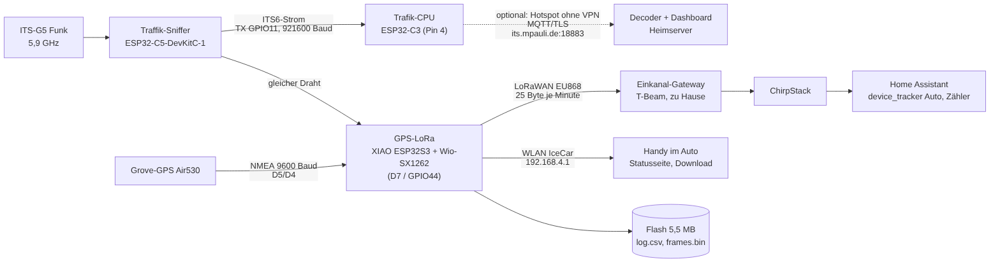
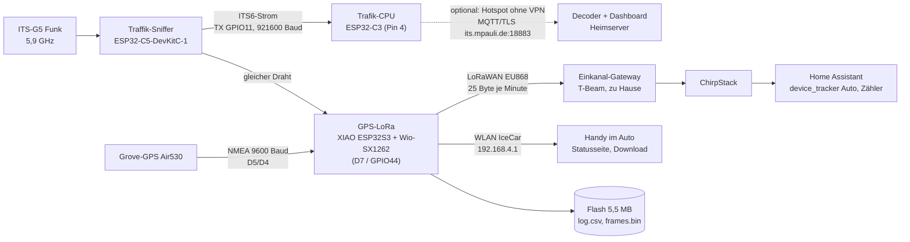
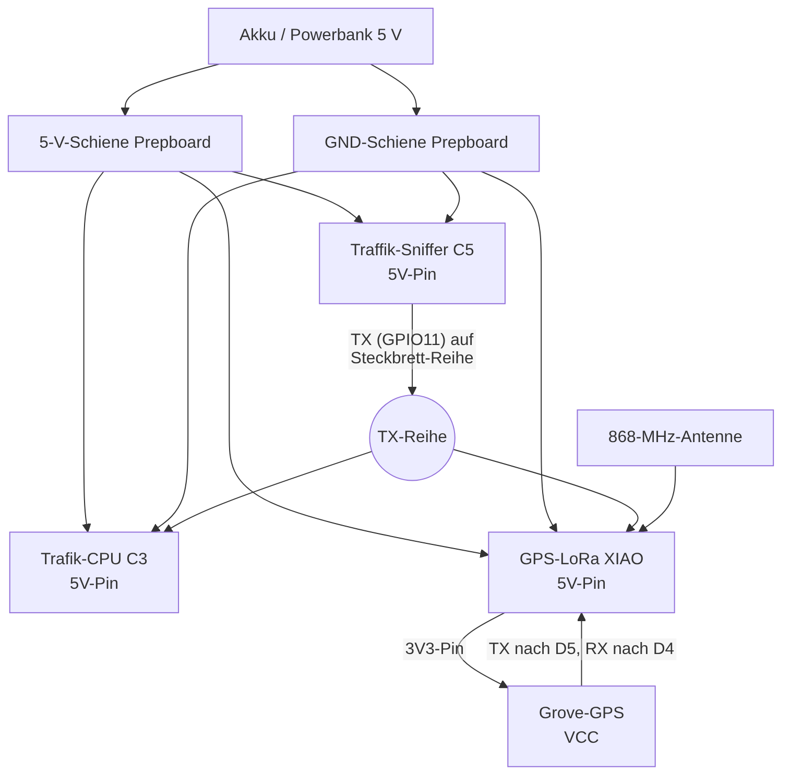
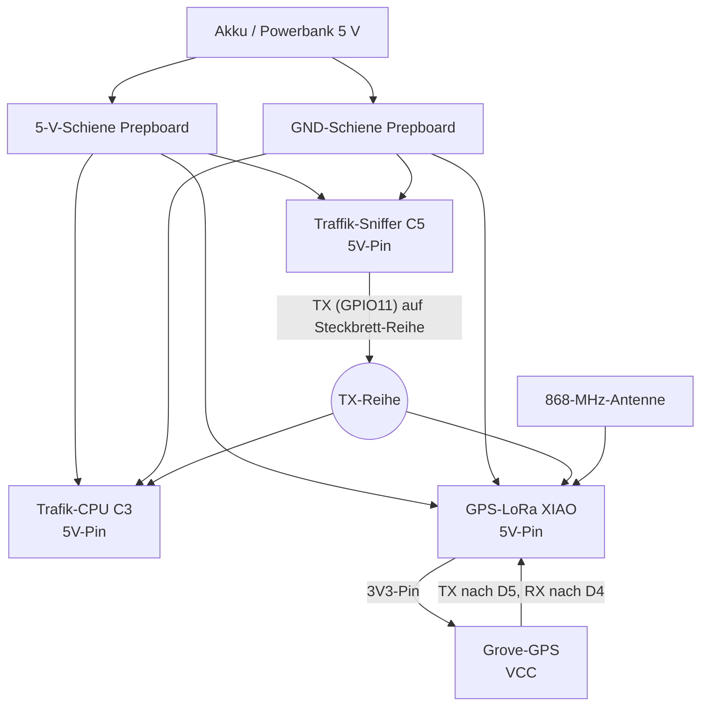
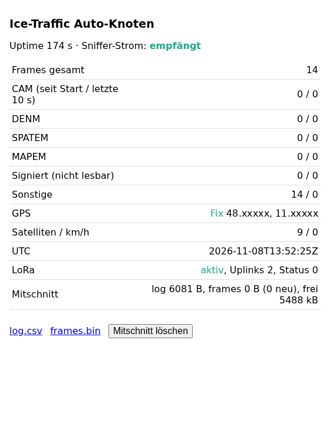
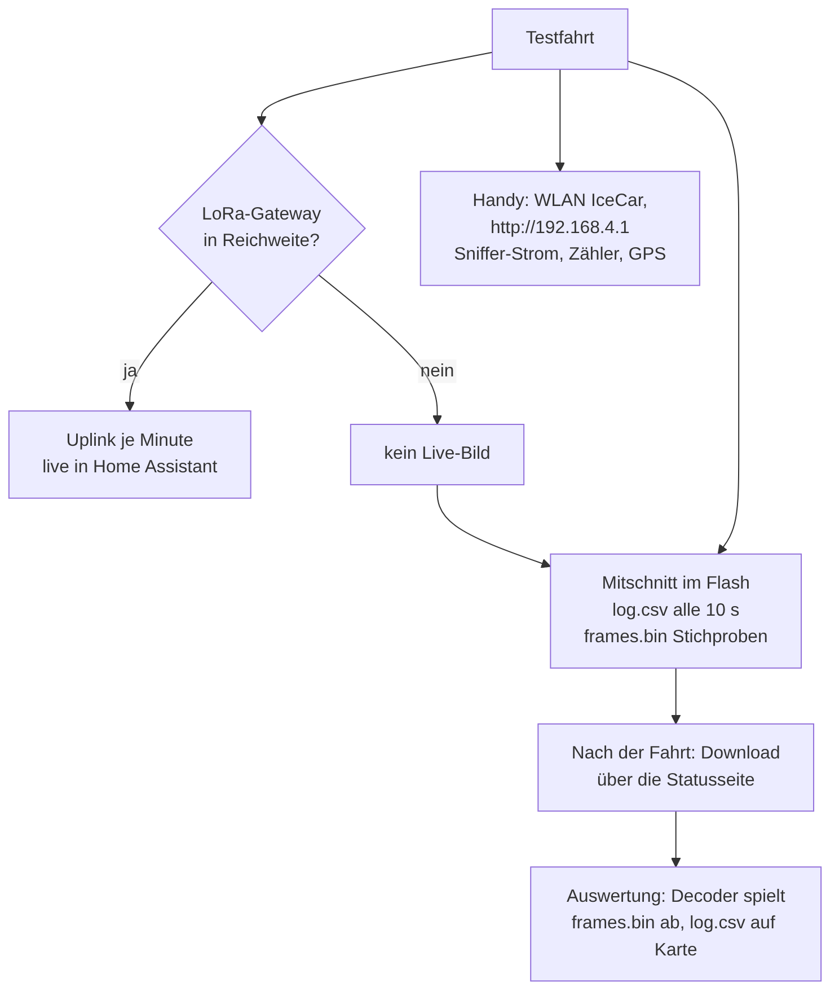
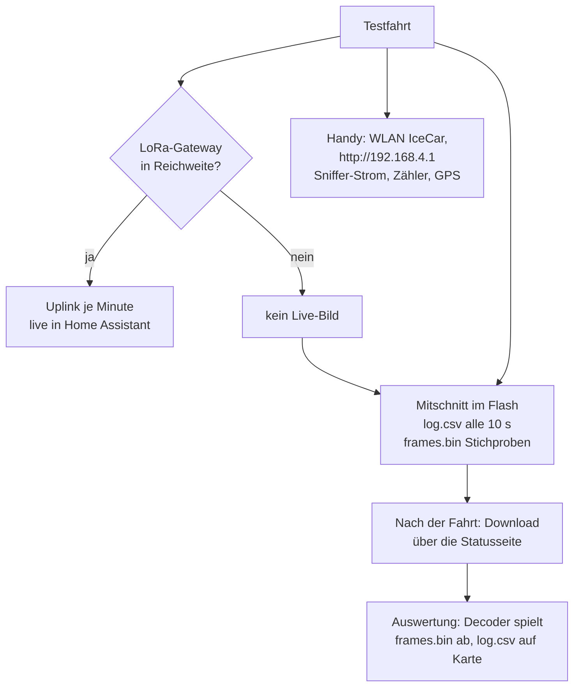

# 18 – Stand Schreibtischtest, Statusseite und Mitschnitt (08.11.2026)

Alle drei Boards laufen am Fenster ohne USB am Akku. Dieses Kapitel hält fest, **was getestet ist**, wie die **Statusseite im Auto** funktioniert und **was auf dem GPS-LoRa gespeichert wird**.

**Gerätenamen** (so werden sie in Doku, Dashboard und Gesprächen genannt)

| Name | Board | Aufgabe |
|---|---|---|
| **Traffik-Sniffer** | ESP32-C5-DevKitC-1-N8R8 | hört ITS-G5 (802.11p, 5,9 GHz) mit, schickt den ITS5-Strom auf TX (GPIO11) |
| **Trafik-CPU** | ESP32-C3-DevKitM-1 | WLAN/MQTT-Brücke zum Heimserver (Eingang Pin 4) |
| **GPS-LoRa** | Seeed XIAO ESP32S3 + Wio-SX1262 + Grove-GPS Air530 | zählt Nachrichtentypen, sendet LoRaWAN, hostet WLAN `IceCar`, speichert den Mitschnitt |

## Datenfluss

Mermaid-Quelltext

Der TX-Draht des Traffik-Sniffers geht über eine Steckbrett-Reihe **parallel** an die Trafik-CPU und das GPS-LoRa. Der Strom ist reines Mithören, nichts läuft zurück.

## Strom und Verdrahtung am Prepboard

Mermaid-Quelltext

> **Nie USB und 5-V-Pin gleichzeitig** an einem Board anschließen. Das Grove-GPS hängt am **3V3**-Pin des XIAO, nicht an 5 V.

| Verbindung | von | nach |
|---|---|---|
| ITS5-Daten | Traffik-Sniffer TX (GPIO11) | Trafik-CPU Pin 4 **und** GPS-LoRa D7 (GPIO44) |
| GPS-Daten | Grove-GPS TX | GPS-LoRa D5 (GPIO6) |
| GPS-Befehle | Grove-GPS RX | GPS-LoRa D4 (GPIO5) |
| Masse | alle Boards | gemeinsame GND-Schiene |

## Statusseite im Auto

Das GPS-LoRa spannt ein eigenes WLAN auf. Damit sieht man **ohne Internet und ohne LoRa-Gateway**, ob Daten ankommen.

1. Am Handy mit dem WLAN **`IceCar`** verbinden (WPA2; das Passwort steht nur lokal in `firmware/lora-car-node/src/secrets.h`, nicht im Repo).
2. Im Browser **`http://192.168.4.1`** öffnen. Die Seite aktualisiert sich alle 2 Sekunden.

*Die Koordinaten im Screenshot sind absichtlich geschwärzt. Die „Sonstigen" stammen von Testtext, den der Sniffer per `send` ausgegeben hat.*

| Anzeige | Bedeutung |
|---|---|
| **Sniffer-Strom** „empfängt" / „KEINE Daten" | ob überhaupt ITS5-Frames vom Traffik-Sniffer ankommen (Draht, Strom, Firmware) |
| Zähler je Typ | CAM, DENM, SPATEM, MAPEM, „signiert (nicht lesbar)", Sonstige – seit Start und in den letzten 10 s |
| GPS | Fix, Position, Satelliten, km/h, UTC |
| LoRa | aktiv/aus, Anzahl Uplinks, Statuscode |
| Mitschnitt | Dateigrößen und freier Speicher |

JSON für eigene Skripte: `http://192.168.4.1/api`.

## Mitschnitt im Flash

Das GPS-LoRa hat 8 MB Flash, davon rund **5,5 MB** als Dateisystem (LittleFS, Partitionstabelle `large_spiffs_8MB`). Zwei Dateien:

| Datei | Inhalt | Umfang |
|---|---|---|
| **`log.csv`** | alle 10 s eine Zeile | rund 25 kB je Stunde |
| **`frames.bin`** | **alle** Rohpakete im **ITS6-Format** (mit RSSI, Rauschpegel und Rate; ältere Mitschnitte enthalten ITS5-Sätze ohne RSSI; beide Formate können in einer Datei stehen) | höchstens 4 MB |

**Spalten `log.csv`:** `utc, uptime_s, fix, lat, lon, kmh, sats, cam, denm, spatem, mapem, signiert, sonstige` und seit der Firmware V1–V4 zusätzlich `rssi_avg, rssi_min, rssi_max, rx_err, unicast, dropped, bad` (alles gilt für das 10-s-Fenster; `utc` ist leer, solange das GPS keine Zeit hat; die RSSI-Spalten sind leer ohne ITS6). `rx_err` = Pakete mit Empfangsfehler (u. a. Prüfsumme), `unicast` = Pakete mit Unicast-Zieladresse, `dropped` = im Sniffer wegen voller Warteschlange verworfen, `bad` = ungültige Rahmen am Empfänger. Zeilen aus älteren Fahrten haben nur 13 Spalten.

**Speichern:** Seit V1 wird **jedes** Paket gespeichert (keine Stichprobe mehr). Die Pakete laufen über einen RAM-Puffer (24 kB) und werden ab 8 kB oder spätestens nach 5 s ins Flash geschrieben; bei Stromausfall gehen höchstens die letzten 5 s verloren. Bleibt weniger als 300 kB frei oder ist `frames.bin` 4 MB groß, stoppt der Mitschnitt (Anzeige „Speicher voll"; die Statusseite zählt die nicht gespeicherten Pakete).

Download und Löschen: Links und Knopf auf der Statusseite (`/log.csv`, `/frames.bin`, `POST /clear`).

## Wie die Testfahrt ablaufen kann

Mermaid-Quelltext

Ein **vollständiger** Mitschnitt aller Pakete ist nur live möglich: Trafik-CPU über den iPhone-Hotspot **ohne VPN** zum öffentlichen TLS-Broker `its.mpauli.de:18883` ([08](08-heimserver.md)). Das iPhone-VPN trägt Hotspot-Clients nicht mit und wird dafür auch nicht gebraucht.

## Was am Schreibtisch getestet wurde

| Test | Ergebnis |
|---|---|
| Traffik-Sniffer → GPS-LoRa (`send`, Testpakete) | Pakete werden gezählt, Statusseite zeigt „empfängt" |
| LoRaWAN-Uplink GPS-LoRa → Gateway → ChirpStack → Home Assistant | läuft im 60-s-Takt, RSSI rund −50 dBm (wenige Meter Abstand) |
| GPS | Fix in unter 3 Minuten am Fenster, 6–9 Satelliten, Position im `device_tracker` |
| Betrieb am Akku ohne USB | Uplinks laufen weiter; Trafik-CPU meldet „online" |
| Statusseite, `log.csv`-Download | funktioniert |
| `frames.bin` mit echten Paketen | **noch nicht getestet** (am Fenster kommen keine Fahrzeuge) |

## Erkenntnisse beim Aufbau

| Thema | Erkenntnis |
|---|---|
| XIAO flashen | Der XIAO-Bootloader (303a:1001) kam erst nach mehreren Versuchen am Server-USB; ein Flash vom Laptop-Browser war unvollständig (`Invalid image block`). Funktionierte: direkt vom Server mit `pio run -t upload`. |
| `activateABP` | Rückgabe **-1118 = `NEW_SESSION`** ist ein **Erfolg**, kein Fehler (Firmware hat es zuerst falsch gewertet). |
| Trafik-CPU | Der Dateneingang vom Sniffer ist **GPIO4 (Pin 4)**, nicht der RX-Pin am Rand. Das Öffnen des seriellen Ports startet das Board neu – darum den Port mit DTR/RTS aus öffnen und kurz warten. |
| Hotspot | iOS tunnelt Hotspot-Clients nicht durchs VPN → öffentlicher TLS-Zugang nötig. |
| Powerbank | Manche Packs schalten bei kleinem Strom ab; die drei Boards ziehen zusammen etwa 300–400 mA. |
| Neustart | Das Öffnen des seriellen Ports am GPS-LoRa löst einen Neustart aus; Zähler beginnen dann bei 0. |

## Noch offen

- Echte ITS-G5-Pakete: erst unterwegs sichtbar (Signatur-Anteil, Common Header, SPATEM/MAPEM).
- `frames.bin` mit echten Paketen prüfen und im Decoder abspielen.
- Einbau im Auto, Stromversorgung 12 V → 5 V, Hotspot-WLAN und TLS-MQTT auf der Trafik-CPU (Phase 6 in [17](17-umsetzungsplan.md)).
- LoRa-Reichweite testen (Gateway steht zu Hause, kleine Antenne).

## Nachtrag 08.11.2026: Klassifizierung korrigiert

Die Testfahrt hat gezeigt, dass die Tabelle der GeoNetworking-Header-Typen in Firmware und Decoder um eins verschoben war. Selbstgebaute Testpakete konnten das nicht aufdecken. Die Zähler „signiert" und „sonstige" aus Messungen vor diesem Datum sind daher nicht verwertbar. Details und Ergebnisse: [20 · Auswertung der ersten Testfahrt](20-auswertung-testfahrt-1.md).
