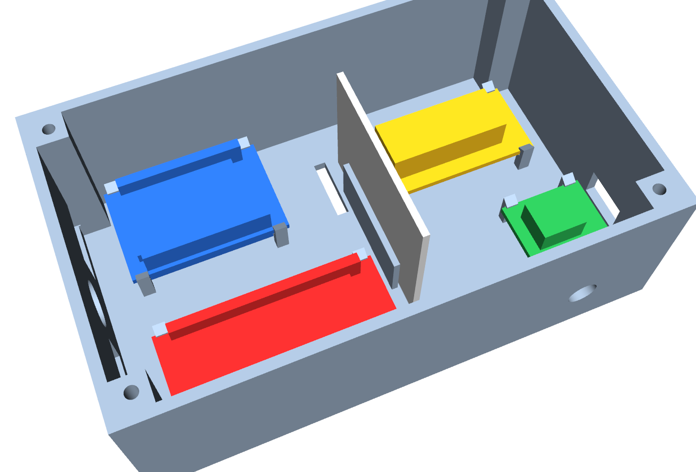
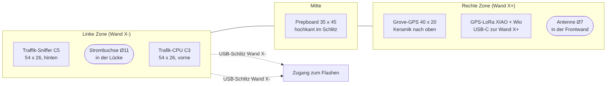
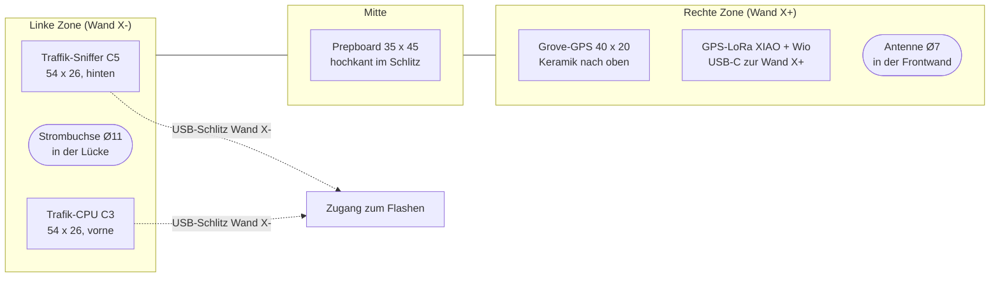
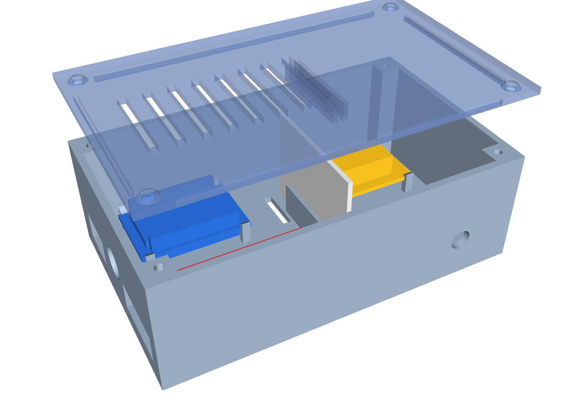
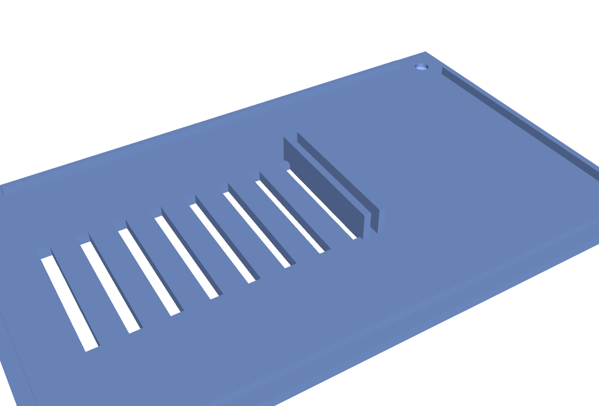

# 19 – Gehäuse (3D-Druck, Entwurf v0.2)

Ein Gehäuse für **alle** Teile: Traffik-Sniffer (C5), Trafik-CPU (C3), GPS-LoRa (XIAO + Wio-SX1262), Grove-GPS und das Prepboard. Konstruiert **parametrisch** mit [CadQuery](https://github.com/CadQuery/cadquery) (`hardware/case/ice_traffic_case.py`). Die STEP-Dateien lassen sich in **SolidWorks** öffnen (Datei → Öffnen → STEP), die STL-Dateien gehen direkt in den Slicer.

> **Status: Entwurf v0.2.** Nur die Länge des Traffik-Sniffers (53,5 mm) ist gemessen. Die übrigen Maße stammen aus Herstellerunterlagen (Espressif-Zeichnung, Seeed-Wiki) oder sind geschätzt (siehe „Maße der Boards"). **Vor dem Druck prüfen** und im Skript oben anpassen.

*Unterteil mit Platzhalter-Boards: rot = Traffik-Sniffer, blau = Trafik-CPU, grün = GPS-LoRa, gelb = Grove-GPS, grau = Prepboard (hochkant). Die Platzhalter sind nur zur Kollisionsprüfung da, sie sind nicht Teil des Drucks.*

## Maße und Bohrungen

| Merkmal | Wert |
|---|---|
| Außenmaß (Unterteil) | 122,8 × 74,8 × 40,4 mm (Innenraum 118 × 70 × 38 mm) |
| Wand / Boden | 2,4 mm |
| **Antenne** | **Ø 7 mm**, Frontwand, Höhe 12 mm, nahe dem GPS-LoRa |
| **Stromanschluss** | **Ø 11 mm**, linke Stirnwand, mittig zwischen C5 und C3, Höhe 16 mm |
| USB-Zugang | ein Schlitz 24 × 10 mm für C5 (2 × USB-C) und 16 × 10 mm für C3 (Micro-USB), linke Wand, ein Schlitz 12 × 8 mm für das GPS-LoRa (rechte Wand; das GPS-LoRa sitzt direkt an dieser Wand) – Flashen ohne Öffnen |
| Deckel | 4 × M3 in Eckdomen (Kernloch 2,8 mm für selbstschneidende Schrauben), Senkung für Linsenkopf, 8 Lüftungsschlitze, Stützlippe |
| Boden | je 4 Schlitze (3 × 16 mm) für Kabelbinder oder Klett zur Befestigung im Auto |

## Aufnahme der Platinen (Clips)

Jede Platine liegt auf vier Auflagen und wird von vier **Schnappclips** in den Ecken gehalten: Auflage 0,8 mm unter der Platine, Haken 0,7 mm über der Platine (oben angeschrägt). Platine **schräg einsetzen** und eindrücken, der dünne Steg (1,2 mm) gibt nach. Zwischen Boden und Platinenunterseite bleiben **5 mm** für die Stiftleisten. Die Clips sitzen in den Ecken, damit sie die Stiftleisten (ab etwa 1 mm Randabstand) nicht berühren.

Das **Prepboard (35 × 45 mm)** steht **hochkant** (45 mm lang, 35 mm hoch) in einem Schlitz aus zwei Rippen (Spalt 1,9 mm = Platine + 0,3 mm). Oben greifen zwei Rippen am Deckel in dieselbe Spur, der Deckel klemmt es also zusätzlich fest.

Mermaid-Quelltext

## Ansichten

## Dateien

| Datei | Zweck |
|---|---|
| `hardware/case/ice_traffic_case.py` | parametrisches Skript (Maße oben im Kopf) |
| `hardware/case/cad/IceTraffic_Gehaeuse_Unterteil.step` / `.stl` | Unterteil |
| `hardware/case/cad/IceTraffic_Gehaeuse_Deckel.step` / `.stl` | Deckel, **in Druckrichtung** (Platte unten) |
| `hardware/case/cad/IceTraffic_Montage_mit_Boards.step` | Zusammenbau mit Platzhalter-Boards, Deckel in Einbaulage (für SolidWorks-Passprüfung) |

Neu erzeugen: `pip install cadquery && python3 hardware/case/ice_traffic_case.py hardware/case/cad`

## Druck auf dem Anycubic Kobra S1

| Einstellung | Empfehlung |
|---|---|
| Werkstoff | **PETG** oder **ASA**, kein PLA (im Auto über 55 °C weich, Sonne hinter der Scheibe reicht) |
| Schicht / Wand | 0,2 mm, 3 Wände, 25 % Füllung |
| Ausrichtung | Unterteil mit der Öffnung nach oben, Deckel mit der Platte unten (so liegt die STL) |
| Stützen | keine nötig (Antennen- und USB-Öffnungen werden überbrückt, Haken sind 45°-Schrägen); bei Problemen Stützen nur für die Öffnungen in den Wänden |
| Passprobe | zuerst nur den Bereich mit einem Clip drucken (ca. 20 min) und eine Platine einsetzen |

Bauraum: das Unterteil (123 × 79 mm) passt bequem auf das Druckbett.

## Maße der Boards (Stand v0.2)

| Board | Maß im Modell | Quelle |
|---|---|---|
| Traffik-Sniffer (ESP32-C5-DevKitC-1) | **53,5 × 25,4 mm** | Länge **gemessen**, Breite Espressif (25,4) |
| Trafik-CPU (ESP32-C3-DevKitM-1) | **38,9 × 25,4 mm** | [Espressif-Maßzeichnung (DXF)](https://dl.espressif.com/dl/schematics/DIMENSION_ESP32-C3-DEVKITM-1_V1_20200915AA.dxf): 25,40 × 38,91; Stiftreihen etwa 22,86 mm auseinander, 1,27 mm vom Rand |
| GPS-LoRa (XIAO ESP32S3 auf Wio-SX1262, B2B-Stapel) | **21 × 17,8 mm**, Höhe geschätzt (ca. 6 mm Bauteile) | [Seeed-Wiki](https://wiki.seeedstudio.com/wio_sx1262_with_xiao_esp32s3_kit/) (21 × 17,8); Stapelhöhe und Lage von USB-C und U.FL **nicht angegeben** |
| Grove-GPS Air530 | **40 × 20 mm**, Höhe bis 13 mm | Händlerangaben, kein Herstellermaß |
| Prepboard | 45 × 35 mm, 1,6 mm dick | Vorgabe |

Die früheren Annahmen (C3 54 mm, XIAO-Stapel 42 × 25 mm) waren falsch und sind korrigiert; dadurch ist das Gehäuse kleiner geworden.

## Noch zu prüfen (Annahmen im Skript)

| Maß | Annahme | Warum wichtig |
|---|---|---|
| Abstand Stiftleiste – Platinenrand und -ende (C5) | ≥ 1 mm | Haken darf nicht auf der Leiste sitzen |
| Lage der USB-Buchsen von C5 und C3 | beide an der linken kurzen Seite | Lage der Schlitze |
| GPS-LoRa: Seite von USB-C und U.FL | USB-C zur rechten Wand, U.FL nach vorn | Schlitz und Antennenbohrung |
| Höhe des GPS-LoRa-Stapels | 6 mm über der Platine | Abstand zum Deckel (unkritisch) |
| Stromanschluss | Einbaubuchse für Ø 11 mm | Einbautiefe bis ca. 14 mm |

Passen die Maße nicht, ändere `C5`, `C3`, `XIAO`, `GPS` am Skriptanfang und erzeuge neu.

## Offene Punkte
- Prepboard-Verdrahtung zu den Buchsen (Strombuchse → 5-V-Schiene) ist im Modell nicht dargestellt.
- Optionaler Halter für Akku/Powerbank außerhalb des Gehäuses.
- GPS-Empfang unter dem Deckel (2,4 mm PETG) vorab testen; sonst Deckelausschnitt über der Keramikantenne.
