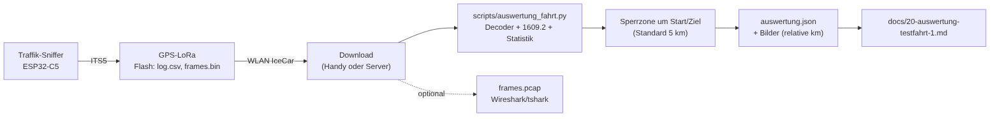
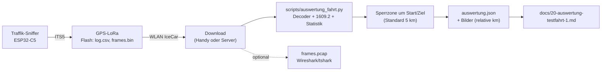
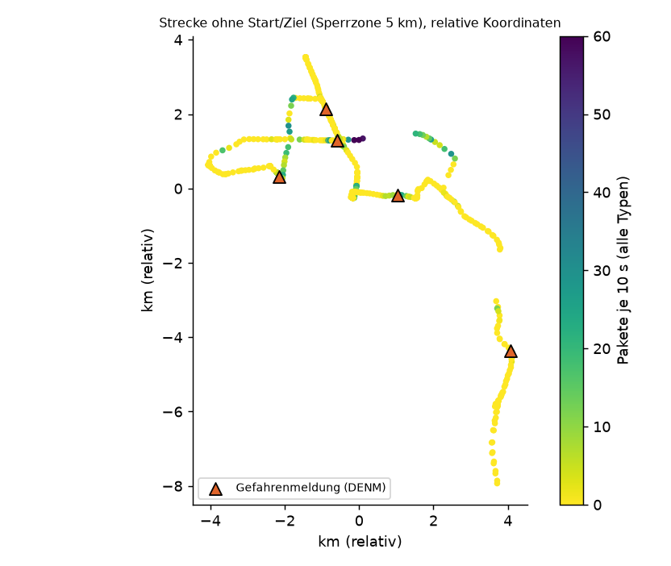
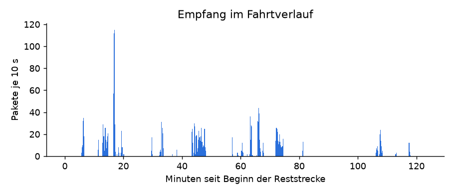
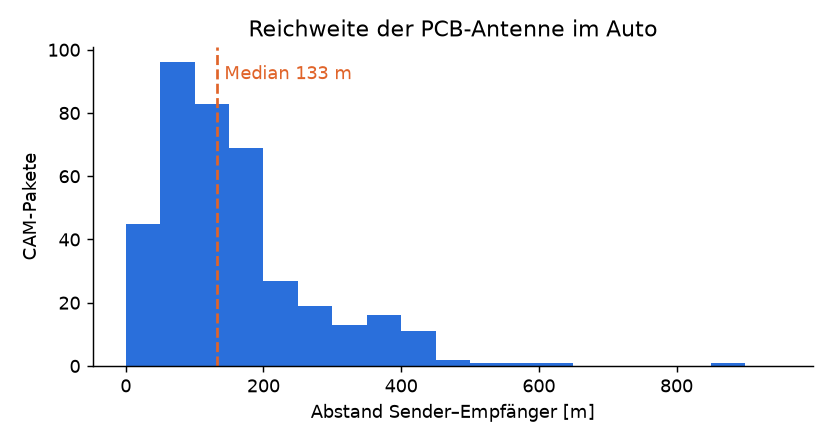
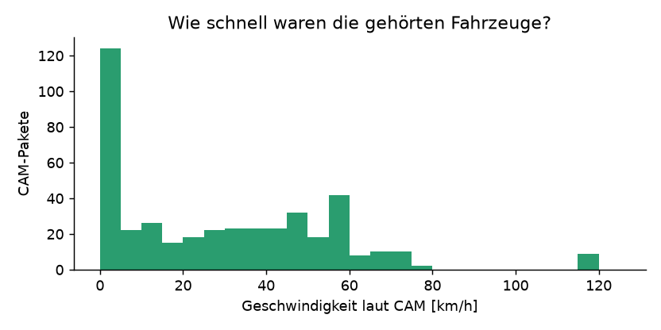
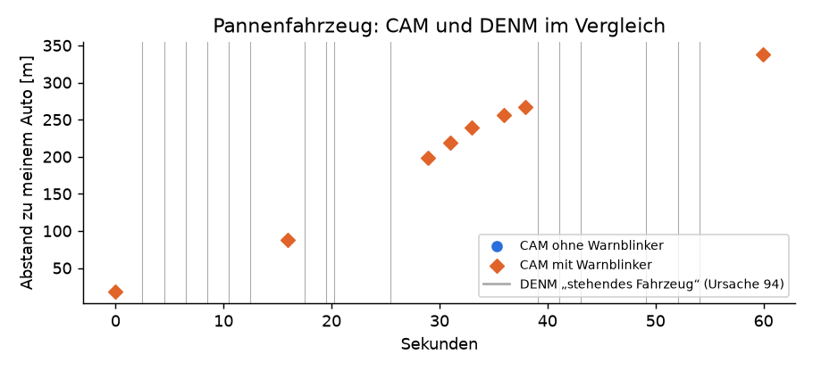
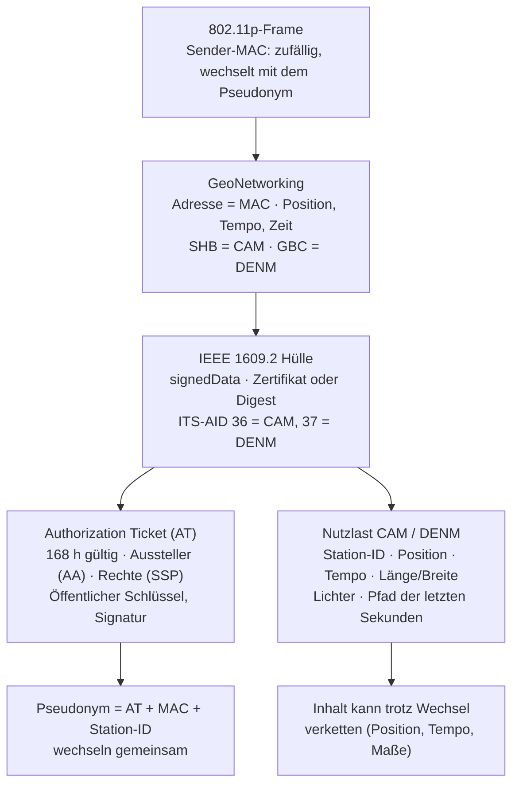

# 20 · Auswertung der ersten Testfahrt

> **Stand 08.11.2026.** Erste Fahrt mit dem Auto-Knoten (Traffik-Sniffer + GPS-LoRa), Auswertung des Mitschnitts aus dem Flash. **Datenschutz:** Start und Ziel sowie ein Umkreis von 5 km sind aus allen Bildern, Tabellen und Zahlen entfernt. Koordinaten stehen nur relativ (km) in den Bildern. Stations-IDs, MAC-Adressen und Zertifikatsschlüssel anderer Fahrzeuge stehen hier nicht.

## Kurzfassung

- **Es kommt echter ITS-G5-Verkehr an.** 455 gespeicherte Pakete in rund 4 Stunden, 453 davon vollständig lesbar: **427 CAM** (Fahrzeug-Positionsmeldungen) und **26 DENM** (Gefahrenmeldungen).
- **Alles ist signiert** (IEEE 1609.2). Wir lesen den Inhalt, prüfen aber **keine** Signaturen.
- **Keine Ampeldaten (SPATEM/MAPEM)** in der gespeicherten Stichprobe. Siehe [Beifang und offene Fragen](#beifang-und-offene-fragen).
- Der Empfang taugt: Median **133 m**, 90 % der CAM unter **340 m**, weitester **954 m**, mit der PCB-Antenne des C5 im Auto.
- **Fehler gefunden und behoben:** Die Tabelle der GeoNetworking-Header-Typen war in Firmware und Decoder um eins verschoben. Der Schreibtischtest mit selbstgebauten Paketen konnte das nicht zeigen. Mit der Korrektur stimmen Firmware, Decoder und **tshark** überein (428 CAM, 26 DENM; ein Paket ist abgeschnitten).

## Wie ausgewertet wurde

Mermaid-Quelltext

Das Skript `scripts/auswertung_fahrt.py` liest `log.csv` und `frames.bin`, entpackt die 1609.2-Hülle, dekodiert CAM und DENM mit den ETSI-Schemas des Decoders und schreibt Kennzahlen (`auswertung.json`) und Bilder. Mit `--pcap` erzeugt es zusätzlich eine pcap-Datei für Wireshark (LINKTYPE 802.11). Die enthält Positionen und bleibt privat.

## Was der Mitschnitt enthält

| Größe | Wert |
|---|---|
| `log.csv` | 1445 Zeilen (10 s), 4,2 h, GPS-Fix in 94 % der Zeilen, höchstens 104 km/h |
| `frames.bin` | 455 Pakete, Stichprobe: höchstens 1 CAM und 1 signiertes Paket je 2 s, DENM immer |
| CAM | 427 Pakete von **39 Sendern**, alle Stationstyp 5 (Pkw) |
| DENM | 26 Pakete aus **6 Ereignissen** |
| unvollständig | 2 Pakete (Signatur abgeschnitten, Empfangsfehler) |

Hinweis zu „39 Sendern": Die Station-ID wechselt mit dem Pseudonym. Es waren also **höchstens** 39 Fahrzeuge, wahrscheinlich weniger.

Die Farbe zeigt die Pakete je 10 s, die Dreiecke Gefahrenmeldungen. Die Lücken sind die Sperrzone und GPS-Aussetzer. Ein Ereignis liegt in der Sperrzone und ist nicht eingezeichnet.

## Reichweite

Gemessen als Abstand zwischen meiner GPS-Position und der Position im CAM des Senders (n = 386):

| Median | 90 % | 99 % | Maximum |
|---|---|---|---|
| 133 m | 337 m | 578 m | 954 m |

Das ist für eine PCB-Antenne im Fahrzeug solide. Eine Außenantenne am Dach würde mehr bringen, ist aber nicht nötig. Die Reichweite ist hier durch Bebauung und Verkehrsdichte begrenzt, nicht durch den Empfänger. Der ITS5-Strom enthält keine Feldstärke (RSSI), deshalb lässt sich die Empfangsqualität nur über den Abstand abschätzen.

## Die Fahrzeuge (CAM)

- Median **26 km/h**, höchstens **119 km/h**. 99 von 427 CAM (23 %) kamen von stehenden Fahrzeugen, vor allem an Ampeln und im Stau.
- **Länge und Breite** (aus dem CAM): 4,1 bis 5,0 m lang, 1,7 bis 1,9 m breit. Das sind klassische Pkw.
- **Außenlichter** (315 CAM mit Low-Frequency-Container): 279× Abblendlicht und Standlicht, 21× Blinker rechts, 5× Blinker links, 2× nur Standlicht und **8× Warnblinker** (siehe [Pannenfahrzeug](#ein-pannenfahrzeug-in-cam-und-denm)).
- **Pfad:** Jedes CAM mit Low-Frequency-Container trägt den Fahrweg der letzten Sekunden mit median **10** Punkten.
- **Fahrzeugrolle:** immer `default`. Kein Einsatzfahrzeug, Bus oder Baustellenfahrzeug in der Stichprobe.

## DENM: sechs Ereignisse

| Ursache | Anzahl | Qualität | Gültig | Besonderheit |
|---|---|---|---|---|
| **1 – Verkehrslage** | 5 | 1 (niedrig) | 60 s | alle `upstreamTraffic`, bis 1 km Relevanz, Fahrspur von 28 bis 35 Punkten, Ereignistempo 0 bis 68 km/h |
| **94 – stehendes Fahrzeug** | 1 (16 Pakete in 52 s) | 3 | 30 s | `allTrafficDirections`, Zusatz „stehend seit < 1 min" |

Die fünf Verkehrslage-Meldungen sehen nach **automatischer Stauerkennung** durch Serienfahrzeuge aus (niedrige Qualität, kein Mensch beteiligt). Das ist eine Deutung. Sie passt zur Form: gleiche Felder, immer Ursache 1/Unterursache 0, immer „stromaufwärts". Drei DENM-Pakete aus zwei Ereignissen kamen **weitergeleitet** (siehe unten).

### Ein Pannenfahrzeug in CAM und DENM

Ein stehendes Fahrzeug sendete 52 Sekunden lang die DENM „stehendes Fahrzeug" (Ursache 94) **und** gleichzeitig CAM mit **Warnblinker** und Geschwindigkeit 0. Mein Auto kam bis auf 19 m heran, die Meldung war bis 340 m zu hören. Das ist der schönste Beleg, dass die Kette stimmt: Sensorwert (Blinker, Tempo) → CAM → DENM → mein Empfänger. Beide Meldungen bestätigen sich gegenseitig.

## Beifang: was in den Signalen noch steckt

Mermaid-Quelltext

### 1. Zertifikate (Authorization Tickets)

- **34 verschiedene ATs** in 453 Paketen. 248 Pakete tragen das Zertifikat, **205 nur den Digest** (8 Byte). 194 davon lassen sich einem Zertifikat aus dem Mitschnitt zuordnen. Das zeigt das übliche Muster: Das volle Zertifikat kommt etwa einmal je Sekunde und sonst nur der Kurzname.
- **Alle 34 ATs gelten genau 168 Stunden (eine Woche) und begannen am selben Tag** (3.11.2026, 03 Uhr UTC). Die Fahrzeuge ziehen ihre Pseudonyme also wochenweise aus einem Vorrat, und alle waren auf demselben Wochenstand.
- **Zwei Aussteller (Authorization Authorities):** 22 ATs von der einen, 12 von der anderen. Die Zuordnung ist **eindeutig**: Alle Fahrzeuge der einen AA melden die Längen-Konfidenz `unavailable`, alle der anderen `trailerPresenceIsUnknown`. Das spricht für **zwei Hersteller-Backends** mit je eigener Fahrzeugsoftware. Welcher Hersteller welcher ist, lässt sich aus den Daten nicht sagen.
- **Rechte (SSP):** Jedes AT erlaubt CAM (`01 00 00`, keine Sonderrechte) und DENM (`01 90 1a 25`). Die Bits des DENM-SSP habe ich nicht aufgelöst; sie sind bei allen gleich, also ohne Aussagekraft für die Unterscheidung.
- **Keine Region** in den Zertifikaten und kein Assurance Level.
- **Zeitstempel:** Die ITS-Zeit im Paket liegt **5,5 s vor** der UTC-Zeit meines GPS (5 bis 7 s). Fünf Sekunden davon sind der Unterschied durch die Schaltsekunden seit 2004, den Rest macht die Laufzeit aus.

### 2. Kennungen auf der Funkebene

- **Alle 40 Sender-MACs sind zufällig** („lokal administriert"). Sie sind bei **450 von 453** Paketen identisch mit der GeoNetworking-Adresse. Die MAC wechselt also mit dem Pseudonym.
- **Drei Pakete (DENM) kamen weitergeleitet:** MAC und GeoNetworking-Adresse unterscheiden sich, und die Hop-Zahl war von 3 auf 2 gesunken. Das ist **Multi-Hop-Weiterleitung** (GeoBroadcast): Ein Fahrzeug hat die Meldung eines anderen erneut gesendet, bei zwei Ereignissen zu sehen.
- **Zwei Muster im Basis-Header (CAM):** Lebensdauer 1 s (`05`) bei 361 Paketen, 0,95 s (`4c`) bei 66 Paketen. `4c` tritt **nur bei Fahrzeugen der einen AA** auf, die andere AA sendet immer `05`. Die AA mit `unavailable` umfasst demnach mindestens **zwei Fahrzeugvarianten** (Software oder Modell). Die DENM tragen eigene Werte (Lebensdauer 15 s, Hop-Limit 3).

### 3. Verkettung der Pseudonyme

Gesucht: Taucht dasselbe Fahrzeug nach einem Wechsel unter neuer ID wieder auf? Ich habe nach Bewegung (letzte Position und Tempo gegen die erste Position der neuen ID innerhalb von 20 s), Länge/Breite und Konfidenzwerten geprüft. Ergebnis: **1 Kandidat** unter 39 Stationen. Die Aussage ist begrenzt, weil die Stichprobe nur ein CAM je 2 s enthält und ein Fahrzeug im Mittel nur **20 s** (maximal 257 s) im Empfang war. Die Literatur beschreibt, dass sich Pseudonyme über Position, Tempo und Maße verketten lassen, auch wenn Zertifikat und MAC wechseln ([ESCHER, KIT](https://ps.tm.kit.edu/downloads/publications/escher21how-1.pdf); [Unlinkability in C-ITS, arXiv](https://arxiv.org/pdf/2301.04130); [ETSI TR 103 415](https://www.etsi.org/deliver/etsi_TR/103400_103499/103415/01.01.01_60/tr_103415v010101p.pdf)). Hier lässt sich das mit dieser Datenmenge weder bestätigen noch widerlegen.

### 4. Beifang und offene Fragen

- **„Sonstige" Pakete: 296 im Log, aber nichts gespeichert.** Davon 273 in nur 40 Sekunden an einer Stelle (52, 104, 93 und 24 Pakete je 10-s-Fenster). Wegen des alten Fehlers wurden **auch unsignierte Nachrichten als „sonstige" gezählt**. Dazu gehören Pakete von Ampeln und Baustellen (RSU), die oft unsigniert oder anders signiert senden. Das ist nur eine Vermutung. Um das zu klären, speichert die Firmware jetzt auch sonstige Pakete (höchstens 1 je Sekunde, `frames.bin`).
- **Ampeln:** Weder SPATEM noch MAPEM in der Stichprobe, weil der Fehler diese Pakete falsch einsortiert hat. Beim nächsten Durchlauf sollten sie als solche erkannt und **immer** gespeichert werden.
- **Zu Hause am Fenster:** In der ersten Stunde 19 sonstige Pakete (2 bis 7 je 10 s), danach nichts. Inhalt unbekannt.
- **Weitere Hinweise zur Auswertung:** Wireshark kann GeoNetworking, BTP, CAM und DENM zerlegen ([Dissector `packet-geonw.c`](https://gitea.osmocom.org/osmocom/wireshark/src/branch/master/epan/dissectors/packet-geonw.c)). tshark liefert für unsere pcap-Datei dieselben Zahlen wie der eigene Decoder und ist damit ein unabhängiger Gegencheck. Die Bedeutung der Ursachen- und Unterursachencodes steht in ETSI TS 102 894-2 (Common Data Dictionary); die Zuordnung 1 = Verkehrslage und 94 = stehendes Fahrzeug stimmt mit der [ETSI-ASN.1-Datei](https://forge.etsi.org/rep/LIBS/LibIts/-/blame/5b527e560dd1a519c7252ad7fc9b27457f997cd0/asn1/ITS-Container/ITS-Container.asn) überein.

## Der Fehler und seine Behebung

Die GeoNetworking-Header-Typen (HT) sind: 1 Beacon, 2 GeoUnicast, 3 GeoAnycast, 4 GeoBroadcast, 5 Topologically-Scoped Broadcast (**HST 0 = Single-Hop-Broadcast, u. a. CAM**), 6 Location Service. Unsere Tabelle war um eins verschoben (SHB als HT 4). Folgen:

- **Firmware:** Die Länge des Extended Headers stimmte nicht, der BTP-Port wurde an falscher Stelle gelesen. **Alle signierten Pakete wurden als „signiert" gezählt, unsignierte als „sonstige".**
- **Decoder:** gleicher Fehler, außerdem fehlte der Aufruf `decode_with_length`, den es für OER-Codecs nicht gibt. Deshalb waren alle 455 Pakete „nicht dekodiert".
- **Warum der Schreibtischtest es nicht fand:** Die selbstgebauten Testpakete (`synth.py`, Tests) benutzten dieselbe falsche Tabelle.
- **Behoben** in `firmware/lora-car-node/src/its_parse.h`, `decoder/its_decoder/gn.py`, Tests aktualisiert, **Testpaket ist jetzt ein echtes CAM** aus dieser Fahrt. Der Decoder-Container auf dem Heimserver ist neu gebaut.

## Nächste Schritte

1. **Zweite Fahrt** mit der korrigierten Firmware (Mitschnitt vorher löschen). Ziel: SPATEM/MAPEM an einer Ampel mit RSU, und der Beifang „sonstige" wird mit gespeichert.
2. **Mitschnitt länger sichern:** Mehr als 1 CAM je 2 s ist möglich, der Flash fasst rund 5 MB. Für die Pseudonym-Verkettung wäre jedes CAM besser als jedes zweite Sekundenpaket.
3. **Signaturen prüfen** (optional): Die ECDSA-Prüfung gegen die Wurzelzertifikate der C-ITS-Vertrauensliste ist möglich, aber nicht nötig, um den Inhalt zu lesen.
4. **Dashboard:** Der Decoder-Container läuft mit der korrigierten Version. Die Anzeige mit echten Fahrdaten ist noch nicht geprüft. Dafür kann der Mitschnitt über den Decoder abgespielt werden.

## Dateien

| Datei | Zweck |
|---|---|
| `scripts/auswertung_fahrt.py` | Auswertung mit Sperrzone, Bildern, JSON, optional pcap |
| `docs/screenshots/auswertung-*.png` | Bilder (relative Koordinaten, ohne Start/Ziel) |
| Vogelbad `testfahrt-2026-11-08/` | **Privat:** Rohdaten `log.csv`, `frames.bin` und `frames.pcap` mit Positionen |
