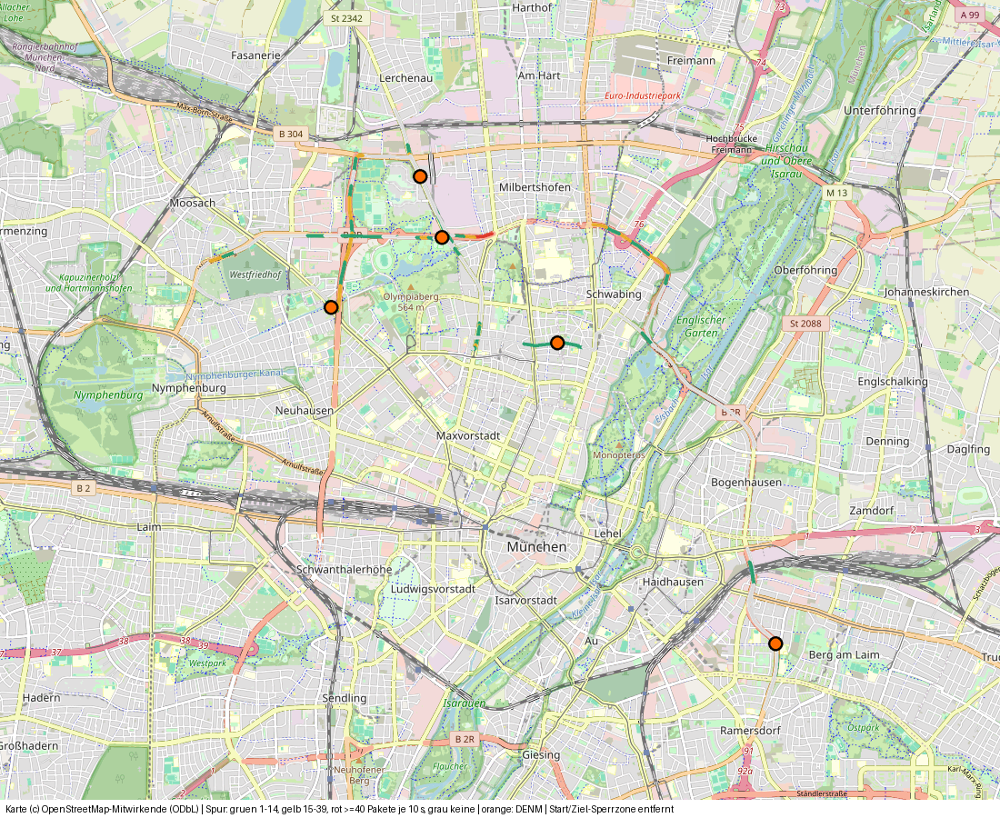
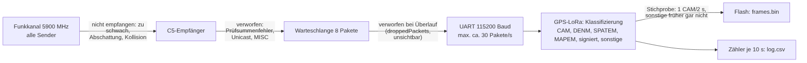
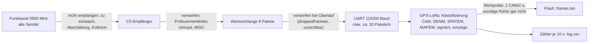

# 21 · Testfahrt 1: Empfangs-Timeline, Karte, Verbesserungen

> **Stand 08.11.2026.** Ergänzt [20 · Auswertung der ersten Testfahrt](20-auswertung-testfahrt-1.md). Alle Zahlen stammen aus **eigenen Messungen** (Mitschnitt dieser Fahrt) oder sind **berechnet**; alles andere hat eine Quelle in eckigen Klammern, aufgelöst im [Quellenverzeichnis](#quellenverzeichnis). Was ich nicht belegen konnte, steht ausdrücklich als „nicht verifiziert“ da.

## 1 · Datenschutz und was im Repo liegt

- **Sperrzone:** Alle Daten im Umkreis von **5 km um den ersten und den letzten GPS-Fix** sind entfernt, ebenso Zeilen und Pakete ohne Position, die zeitlich daran grenzen (±120 s). Die Heimatadresse und ihre Umgebung kommen in keiner Datei, keinem Bild und keiner Karte vor. Die Karte zeigt nur den Ausschnitt um die Empfangsstellen und **keinen Kreis um die Sperrzone** (ein Kreis würde den Mittelpunkt verraten).
- **Rohdaten privat:** Die unbereinigten Dateien bleiben auf dem Heimserver.
- **Dritte:** Die bereinigten Pakete enthalten Positionen, Zeiten und Pseudonym-Kennungen **anderer Verkehrsteilnehmer**, die ohnehin unverschlüsselt ausgesendet werden. Die Kennungen wechseln wochenweise (siehe [20](20-auswertung-testfahrt-1.md#1-zertifikate-authorization-tickets)). Wer das nicht veröffentlichen möchte, löscht `frames_bereinigt.*`.

| Datei in `ergebnisse/testfahrt-1/` | Inhalt |
|---|---|
| `daten/log_bereinigt.csv` | 721 von 1445 Zeilen (10-s-Fenster) |
| `daten/frames_bereinigt.bin` | 427 von 455 Paketen im ITS5-Format (abspielbar im Decoder) |
| `daten/frames_bereinigt.pcap` | dieselben Pakete für Wireshark (LINKTYPE 802.11) |
| `empfang_timeline.csv` | 132 Empfangsfenster mit GPS-Position, Paketzahlen und Adresse |
| `empfang_abschnitte.csv` | 23 zusammenhängende Empfangsabschnitte |
| `denm_ereignisse.json` | 5 Gefahrenmeldungen mit Adresse (ein 6. Ereignis lag in der Sperrzone) |

Erzeugt mit `scripts/ergebnisse_testfahrt.py` (Sperrzone, Adressen, Karte) und `scripts/auswertung_fahrt.py` (Statistik, Bilder).

## 2 · Karte der Empfangsstellen

**Interaktive Karte:** [karte-testfahrt-1.html](karte-testfahrt-1.html) (GitHub Pages: <https://icepaule.github.io/Ice-Traffic-Data/karte-testfahrt-1.html>). Ein Klick auf einen Punkt zeigt Zeit, Pakete und Adresse.

Kartendaten © OpenStreetMap-Mitwirkende, ODbL ([OSM-Urheberrecht](https://www.openstreetmap.org/copyright)). Die Kacheln werden unter der [OSMF-Tile-Nutzungsrichtlinie](https://operations.osmfoundation.org/policies/tiles/) in kleiner Zahl geladen.

## 3 · Timeline der effektiven Empfänge

Ein **Empfangsfenster** ist ein 10-s-Fenster des Logs mit mindestens einem Paket und GPS-Fix. Es gibt **132** davon, in **23 Abschnitten** (Lücke über 30 s trennt). Die vollständige Liste mit Koordinaten (5 Nachkommastellen) und Adresse steht in `empfang_timeline.csv`.

| Nr | UTC (von–bis) | Dauer | Straße(n) | Ortsteil | Pakete | davon „sonstige“ | km/h (Median) |
|---|---|---|---|---|---|---|---|
| 1 | 15:26:50–15:27:43 | 63 s | Innsbrucker Ring > Grafinger Straße | Berg am Laim | 106 | 0 | 34 |
| 2 | 15:32:28–15:32:38 | 20 s | Isarring | Schwabing | 21 | 0 | 57 |
| 3 | 15:34:01–15:35:47 | 116 s | Schenkendorfstraße > Isarring > ? | Schwabing | 168 | 0 | 44 |
| 4 | 15:37:43–15:38:23 | 50 s | Petuelring > B 2R | Milbertshofen-Am Hart | 317 | 273 | 41 |
| 5 | 15:38:56–15:39:39 | 53 s | Lerchenauer Straße | Milbertshofen-Am Hart | 13 | 0 | 30 |
| 6 | 15:40:19–15:41:12 | 63 s | Lerchenauer Straße | Milbertshofen-Am Hart | 36 | 0 | 26 |
| 7 | 15:50:38–15:50:58 | 30 s | Lerchenauer Straße | Milbertshofen-Am Hart | 24 | 0 | 0 |
| 8 | 15:53:27–15:54:40 | 83 s | Lerchenauer Straße > Petuelring | Milbertshofen-Am Hart | 100 | 1 | 27 |
| 9 | 15:57:49–15:57:49 | 10 s | Spiridon-Louis-Ring | Milbertshofen-Am Hart | 2 | 0 | 0 |
| 10 | 15:59:22–15:59:22 | 10 s | Lerchenauer Straße | Milbertshofen-Am Hart | 6 | 3 | 46 |
| 11 | 16:04:26–16:09:11 | 295 s | Landshuter Allee > Dachauer Straße > Moosacher Straße | Milbertshofen-Am Hart | 392 | 0 | 34 |
| 12 | 16:18:15–16:18:25 | 20 s | Wintrichring | Moosach | 19 | 0 | 69 |
| 13 | 16:20:01–16:20:11 | 20 s | Georg-Brauchle-Ring | Moosach | 4 | 0 | 47 |
| 14 | 16:21:24–16:21:57 | 43 s | Georg-Brauchle-Ring | Milbertshofen-Am Hart | 24 | 0 | 61 |
| 15 | 16:23:20–16:23:20 | 10 s | Georg-Brauchle-Ring | Milbertshofen-Am Hart | 2 | 0 | 0 |
| 16 | 16:24:13–16:25:16 | 73 s | Georg-Brauchle-Ring > Spiridon-Louis-Ring > Petuelring | Milbertshofen-Am Hart | 110 | 0 | 9 |
| 17 | 16:26:38–16:27:54 | 86 s | Petuelring > Lerchenauer Straße | Milbertshofen-Am Hart | 173 | 0 | 2 |
| 18 | 16:28:34–16:28:57 | 33 s | Lerchenauer Straße > Luz-Long-Ufer | Milbertshofen-Am Hart | 20 | 0 | 23 |
| 19 | 16:33:09–16:35:35 | 156 s | Schleißheimer Straße > Mitterwieserstraße > Herzogstraße | Schwabing | 218 | 0 | 5 |
| 20 | 16:42:12–16:42:22 | 20 s | Mitterwieserstraße | Schwabing | 18 | 0 | 0 |
| 21 | 17:07:13–17:09:29 | 146 s | Herzogstraße | Schwabing | 107 | 0 | 29 |
| 22 | 17:14:01–17:14:14 | 23 s | Dietlindenstraße > Isarring | Schwabing | 5 | 0 | 38 |
| 23 | 17:18:36–17:18:56 | 30 s | Leuchtenbergring | Haidhausen | 17 | 0 | 59 |

„Sonstige“ ist die Zählung der **alten** Firmware (siehe [20](20-auswertung-testfahrt-1.md#der-fehler-und-seine-behebung)): Sie umfasst alles, was nicht als signiert eingestuft wurde.

**So wurden Straße und Hausnummer bestimmt:** Reverse-Geocoding der GPS-Position mit Nominatim (OSM, Detailstufe 18) [14]. Die Straße kam bei **131 von 132** Fenstern zurück, eine **Hausnummer nur bei 27**: Nominatim liefert sie nur, wenn die Position innerhalb eines OSM-Gebäudes mit Adresse liegt oder dort sehr nahe. Auf einer Straße ist das selten. Die Hausnummer ist deshalb **nur ein Hinweis auf das nächstgelegene Gebäude**, keine Aussage über die Position des Autos. Die GPS-Genauigkeit des Air530 beträgt laut Hersteller horizontal **2,5 m (50 % CEP)** bei freier Sicht [13]. Zwischen Häusern oder unter Bäumen ist sie schlechter.

### Kennzahlen

| Messung | Wert |
|---|---|
| Fenster mit GPS-Fix außerhalb der Sperrzone | 677 (1,9 h) |
| davon mit mindestens 1 Paket | 132 (**19 %**) |
| Pakete in diesen Fenstern | 1902 (davon 277 „sonstige“) |
| Median der Pakete je Empfangsfenster | 10 je 10 s |
| Maximum | 115 Pakete in 10 s (≈ 11 Pakete/s) |

**Empfang nach Geschwindigkeit** (Fenster mit GPS-Fix):

| Geschwindigkeit | Fenster | davon mit Empfang | Pakete je 10 s (Mittel) |
|---|---|---|---|
| Stand (< 2 km/h) | 320 | 11 % | 1,4 |
| 2–30 km/h | 132 | 30 % | 4,1 |
| 30–60 km/h | 173 | 28 % | 4,5 |
| ≥ 60 km/h | 52 | 21 % | 2,5 |

**Ursachen lassen sich aus diesen Zahlen nicht trennen**: Verkehrsdichte, Abschattung durch Gebäude und die Antenne wirken zusammen. Dafür fehlt die Feldstärke (siehe Verbesserung V2).

### Auffällige Stellen

- **Abschnitt 4 (Petuelring / B 2 R):** 317 Pakete in 50 s, davon **273 „sonstige“**. An dieser Stelle empfing der Knoten in 10-s-Fenstern 52, 104, 93 und 24 sonstige Pakete. Das ist das größte Beifang-Ereignis der Fahrt. Gespeichert wurde davon nichts (alte Firmware). Was es war, lässt sich aus den Daten nicht sagen. Die neue Firmware speichert solche Pakete künftig (V5).
- **Abschnitt 21 (Herzogstraße):** Hier stand das Fahrzeug mit Warnblinker, das gleichzeitig DENM „stehendes Fahrzeug“ (Ursache 94) sendete (siehe [20](20-auswertung-testfahrt-1.md#ein-pannenfahrzeug-in-cam-und-denm)).
- **Lerchenauer Straße und Spiridon-Louis-Ring:** Diese Straßen sind in [06](06-testfahrt.md) als erster Test an einer bekannten RSU im TEMPUS-Testfeld genannt und tauchen in der Timeline mehrfach auf (Abschnitte 5–10). Eine Ampel-RSU ist daran **nicht belegt**: Es ist keine SPATEM- oder MAPEM-Nachricht gespeichert.

### Die fünf DENM-Ereignisse mit Adresse

| UTC | Straße | Ursache | Pakete |
|---|---|---|---|
| 15:27:15 | Innsbrucker Ring (Berg am Laim) | 1 Verkehrslage | 1 |
| 15:50:41 | Lerchenauer Straße (Milbertshofen) | 1 Verkehrslage | 1 |
| 16:08:33 | Dachauer Straße 265 (Neuhausen) | 1 Verkehrslage | 6 |
| 16:24:26 | Georg-Brauchle-Ring (Milbertshofen) | 1 Verkehrslage | 1 |
| 17:08:28 | Herzogstraße (Schwabing) | **94 stehendes Fahrzeug** | 16 |

Die Positionen sind **Ereignispositionen aus der Nachricht** (vom sendenden Fahrzeug gemessen), nicht meine Position.

## 4 · Was die Technik erwarten lässt: Link-Budget

**Frage:** Ist die gemessene Reichweite (Median 133 m, 90 % unter 337 m, Maximum 954 m, [20](20-auswertung-testfahrt-1.md#reichweite)) durch die Funkstrecke begrenzt, oder durch etwas anderes?

**Ableitung (Freiraum):** Die Freiraumdämpfung ist `FSPL = 20·log10(d_km) + 20·log10(f_MHz) + 32,44` dB [11]. Bei 5900 MHz (G5-CCH, [1]):

| Abstand | FSPL | Empfangspegel bei 33 dBm EIRP, Antenne 0 dBi |
|---|---|---|
| 133 m | 90,3 dB | −57,3 dBm |
| 337 m | 98,4 dB | −65,4 dBm |
| 578 m | 103,1 dB | −70,1 dBm |
| 954 m | 107,4 dB | −74,4 dBm |

- **33 dBm** ist die **Obergrenze** der Sendeleistung (EIRP) im Band 5855–5925 MHz nach ETSI EN 302 571, Tabelle 3 [1]. Die Norm sieht Leistungsregelung vor ( [1] Abschn. 6.3 „RF Output Power, Transmit Power Control (TPC) and Power Spectral Density“). Die tatsächliche Sendeleistung der gehörten Fahrzeuge kenne ich nicht.
- Die geforderte **Mindestempfindlichkeit** bei 10 MHz Kanalbreite und 10 % Paketfehlerrate beträgt −85 dBm (BPSK 1/2), **−82 dBm (QPSK 1/2)** und −68 dBm (64-QAM 3/4) [1, Tabelle 10b].
- Der Empfänger des C5 gibt für 802.11a bei 6 Mbit/s eine typische Empfindlichkeit von **−92,5 dBm** an, aber für **20 MHz** Kanalbreite [5, Tabelle 7-10]. Für 10 MHz und für 5900 MHz nennt das Datenblatt keinen Wert.

**Rechnung:** Mit −82 dBm als Schwelle, 33 dBm EIRP und 0 dBi Empfangsantenne ergibt die Freiraumformel **2,3 km**; mit −85 dBm 3,2 km. Die gemessenen **954 m** liegen darunter.

**Schluss (begründet):** Die Funkstrecke im Freiraum reichte rechnerisch deutlich weiter als gemessen. Begrenzend waren daher vermutlich **Abschattung durch Gebäude und Fahrzeuge, Mehrwegeausbreitung, geringere Sendeleistung und die Antenne im Fahrzeug**, nicht das Rauschen im Freiraum. Das ist eine **Folgerung aus der Rechnung, keine Messung**. Eine Antenne mit höherem Gewinn hilft dann nur begrenzt. Belegen lässt es sich erst mit Feldstärkewerten (V2).

**Antennengewinn in Zahlen:** Pro **6 dB** Gewinn verdoppelt sich die Freiraum-Reichweite [11b]. Das Datenblatt der Taoglas GSA.8859 nennt auf Glas mit 1 m Kabel einen Spitzengewinn von **4,14 dBi** bei einem mittleren Gewinn von **−2,12 dBi** und einem Wirkungsgrad von **61 %** [9]. Die Spanne zwischen mittlerem und Spitzengewinn zeigt: Die Zahl auf dem Datenblatt gilt nur in einer Richtung.

## 5 · Befunde am Empfänger (aus dem Quelltext)

Der Sniffer (`bertrik/its-g5-receiver`, Stand `45db567`, Datei `esp32-c5-sniffer/esp32-c5-sniffer.ino`) [8] tut Folgendes:

| Befund | Stelle im Quelltext | Folge |
|---|---|---|
| Kanal **5900 MHz** (`CHANNEL = 5900`, `phy_change_channel(CHANNEL, 1, 0, 0)`) | Zeilen 21, 192 | passt zu G5-CCH [1] |
| Das Datenblatt gibt den Mittenfrequenzbereich mit **5180–5885 MHz** an | [5, Tabelle 7-7] | 5900 MHz liegt **außerhalb** der spezifizierten Werte: Empfindlichkeit dort nicht garantiert |
| Filter: **Pakete mit Prüfsummenfehler** werden verworfen (`& ~WIFI_PROMIS_FILTER_MASK_FCSFAIL`, `rx_ctrl.rx_state` ≠ 0) | Zeilen 111, 186 | Verluste durch Fehler sind unsichtbar |
| Es werden nur Pakete mit **Broadcast-Zieladresse** weitergegeben | Zeile 114 | Unicast-Pakete (z. B. von RSU an einzelne Fahrzeuge) fehlen |
| **Warteschlange mit 8 Paketen**, Zähler `droppedPackets` | Zeilen 22, 118 | bei Lastspitzen gehen Pakete verloren; der Zähler wird nicht an die GPS-LoRa übertragen |
| Ausgabe mit **115200 Baud** (`Serial0.begin(115200)`) | Zeile 171 | siehe V3 |
| `rssi`, `noise_floor`, `channel`, `timestamp` stehen in `rx_ctrl`, werden aber **nicht** weitergegeben | Zeilen 97–123 | keine Feldstärke im ITS5-Strom |

Dass `rssi`, `noise_floor` und `timestamp` in den Empfangsdaten des ESP-IDF enthalten sind, zeigen die Strukturen `wifi_pkt_rx_ctrl_t` und `esp_wifi_rxctrl_t` [7]. Die HE-Struktur (für Chips mit Wi-Fi 6 vorgesehen; ob der C5 sie verwendet, habe ich **nicht geprüft**) hat **kein Bandbreitenfeld** [7]. Ob die Hardware tatsächlich 10-MHz-Pakete decodiert, ist hier **nicht belegt**: Die Dekodierung gelingt offensichtlich (453 von 455 Paketen), aber ein Rückschluss auf die Empfindlichkeit ist daraus nicht möglich.

## 6 · Verbesserungsvorschläge

Wo Information auf dem Weg vom Funkkanal bis in den Flash verloren geht, zeigt die Kette (nach dem Quelltext [8] und der Firmware des Knotens):

Mermaid-Quelltext

Jeder Vorschlag nennt Befund, Begründung und Maßnahme. Die Reihenfolge entspricht dem Verhältnis von Nutzen und Aufwand.

### V1 · Alle Pakete speichern statt Stichproben (Aufwand: klein)

- **Befund (Messung):** Im Log stehen 1674 signierte und 277 sonstige Pakete (bereinigt) bzw. 1872 + 296 über die ganze Fahrt von 4,2 h. Ein gespeichertes Paket belegt im Mittel **376 Byte** (171 060 B / 455 Pakete).
- **Rechnung:** 2168 Pakete × 376 B = **0,82 MB**. Der Flash hat rund 5,2 MB frei, das Limit für `frames.bin` liegt bei 3 MB. Alle Pakete einer Fahrt dieser Länge passen also hinein.
- **Warum es wichtig ist:** Ein CAM wird mindestens alle 1000 ms und höchstens alle 100 ms gesendet, ausgelöst durch 4° Kursänderung, 4 m Wegstrecke oder 0,5 m/s Geschwindigkeitsänderung [4, Abschn. 6.1.3]. Unsere Stichprobe von 1 CAM je 2 s erfasst höchstens **5 %** der CAM eines schnell fahrenden Senders. Für die **Verkettung von Pseudonymen** (Hidden-Markov-Modelle, Trajektorien-Vergleich) braucht man lückenlose Folgen [15].
- **Maßnahme:** Stichprobenbegrenzung entfernen, solange mehr als 300 kB frei sind. Danach ältere Pakete nicht überschreiben, sondern den Mitschnitt anhalten (so wie bisher).

### V2 · Feldstärke (RSSI), Rauschpegel, Kanal und Zeit mitschicken (Aufwand: mittel)

- **Befund:** Der Treiber liefert `rssi`, `noise_floor`, `channel` und einen µs-Zeitstempel je Paket [7]. Der Sniffer verwirft sie [8].
- **Begründung:** Ohne Feldstärke ist keine der folgenden Fragen messbar: Welche Antenne ist besser? Wie weit sind Pakete im Rauschen? Wo liegt die Empfangsgrenze? Die Abschätzung in Abschnitt 4 bleibt eine Rechnung.
- **Maßnahme:** ITS5-Rahmen um 4 Byte erweitern (Version 2: `rssi` (int8), `noise_floor` (int8), `channel` (uint8), Flags). Der Decoder bleibt für Version 1 kompatibel. In `log.csv` zusätzlich Median-RSSI je Fenster.
- **Messung danach:** Auftragen von RSSI über Abstand (Abschnitt 4) für jede Antenne. Daraus folgt die Reichweitenkurve und ein Vergleich mit dem Freiraummodell.

### V3 · Datenrate der Leitung zur GPS-LoRa und Verlustzähler (Aufwand: klein)

- **Rechnung:** 115 200 Baud mit 8N1 sind 11 520 Byte/s (10 Bit je Byte). Bei 376 Byte je Paket (ITS5-Kopf 14 Byte + Paket) fasst die Leitung höchstens **30 Pakete/s**. **Drei Fahrzeuge** mit je 10 Hz CAM [4] würden sie bereits auslasten.
- **Messung:** In dieser Fahrt lag das Maximum bei **≈ 11 Paketen/s** (115 in 10 s). Die Leitung war also nicht erkennbar ausgelastet. Verluste, die in der Warteschlange des Sniffers entstanden (`droppedPackets`), sind allerdings **nicht sichtbar**.
- **Planungsgröße:** Der C2C-CC nimmt als Auslegungsfall bis zu **400 empfangene Pakete/s** an [2]. Das sind rund 150 kB/s bzw. etwa **1,5 Mbaud**. Mit 921 600 Baud (≈ 245 Pakete/s) wäre ein Mehrfaches des bisherigen Maximums möglich.
- **Maßnahme:** Baudrate auf mindestens 921 600 anheben (beide Seiten), `droppedPackets` mit ausgeben und im Log führen. Ob der UART des C3/C5 und der XIAO die höhere Rate zuverlässig schaffen, habe ich **nicht verifiziert**. Das wäre ein Test am Schreibtisch.

### V4 · Fehlerhafte und adressierte Pakete mitzählen (Aufwand: klein)

- **Befund:** Der Sniffer verwirft Pakete mit Prüfsummenfehler und alle ohne Broadcast-Zieladresse [8].
- **Begründung:** Die Zahl der Fehlerpakete ist ein direktes Maß für Störungen und Grenzreichweite. Der Anteil von Paketen mit Prüfsummenfehler steigt zum Rand der Empfangsreichweite. Ohne diesen Zähler wissen wir nicht, ob 954 m das Maximum der Funkstrecke oder der Beginn der Fehlerzone war.
- **Maßnahme:** Zähler je Fenster für `FCSFAIL` und für verworfene Unicast-Pakete (nur zählen, nicht speichern).

### V5 · Beifang genauer klassifizieren (Aufwand: klein bis mittel)

- **Befund:** 277 „sonstige“ Pakete ohne Detail. Die Firmware kennt zudem nur BTP-B-Ports 2001–2004. Die Port-Tabelle nennt aber weitere: 2005 SAEM, 2006 IVIM, 2007/2008 SREM/SSEM, 2009 CPM, 2010 EVCSN POI und weitere [3, Tabelle 1].
- **Folge:** IVIM (Verkehrsinformation von Infrastruktur), CPM (Wahrnehmung anderer Fahrzeuge) und SREM/SSEM (Anforderung von Ampelbevorzugung) würden in „sonstige“ einfließen.
- **Maßnahme (technisch):**
  1. Zähler je **Ethertype** (0x8947 GeoNetworking, andere), je **Basic-Header-NH** (unsigniert, signiert, anderes), je **GN-Header-Typ** (Beacon, SHB, GBC, LS …, Tabelle ETSI EN 302 636-4-1) und je **BTP-Port** nach Tabelle [3].
  2. Zusätzlich je Fenster die drei häufigsten Ports im Log.
  3. Die ersten 5 Pakete je neuer Klasse und je Fahrt immer speichern.
- **Wireshark als Gegenprobe:** Der Dissector `packet-geonw.c` zerlegt GeoNetworking, BTP und CAM/DENM [16]. Er hat unsere 454 Pakete bis auf eines (abgeschnitten) wie der eigene Decoder eingeordnet (428 CAM, 26 DENM).
- **Deutungshypothesen für den Burst am Petuelring** (alle nicht belegt): unsignierte Nachrichten einer RSU, Nachrichten mit anderem BTP-Port (z. B. IVIM, CPM), Pakete mit anderem Header-Typ. Nur das Speichern der Pakete (V1/V5) kann das klären.

### V6 · Zweiter Empfangskanal nur bei Bedarf (Aufwand: hoch)

- **Befund:** Der C2C-CC ordnet für den Start CAM, DENM, SPATEM, MAPEM und IVIM dem **Kanal SCH0** zu, den ersten Hop jeweils. Nur weitergeleitete DENM bei hoher Last sollen auf **SCH1** ausweichen [2, Tabelle 4]. Der Kanalplan nennt G5-CCH = **5900 MHz**, G5-SCH1 = 5880 MHz, G5-SCH2 = 5890 MHz [1].
- **Folge:** Ein Empfänger auf 5900 MHz deckt die für uns wichtigen Nachrichten ab. Ein zweiter Kanal lohnt erst, wenn weitere Dienste interessieren.
- **Maßnahme:** Zurückstellen. Wenn doch: zweiter C5 mit `CHANNEL = 5880`, Auswertung getrennt. Das braucht einen zweiten UART/Port am Knoten.

### V7 · Antenne (Aufwand: mittel; erst nach V2 sinnvoll)

**Ausgangslage (Fakten):**
- Das **ESP32-C5-DevKitC-1-N8R8** hat laut Espressif eine **PCB-Antenne auf der Platine** [6]. Eine U.FL-Buchse ist dort nicht erwähnt.
- Das **ESP32-C5-WROOM-1U** „comes with a connector“ für eine externe Antenne; das Modul WROOM-1 hat eine PCB-Antenne [5].
- Eine Platine mit dem WROOM-1U und U.FL-Buchse bietet laut Herstellerangabe DFRobot an (FireBeetle 2 ESP32-C5-U) [17]. **Nicht verifiziert:** Lieferbarkeit, Pinbelegung für den Sniffer und ob die Firmware ohne Änderung läuft.

**Antennen für 5,9 GHz mit Datenblatt:**

| Typ | Gewinn | Besonderheiten | Quelle |
|---|---|---|---|
| Taoglas **GSA.8859.A.105111** (Klebe-Antenne) | 4,14 dBi Spitze, −2,12 dBi mittel (auf Glas, 1 m Kabel), Wirkungsgrad 61 % | omnidirektional, 5850–5925 MHz, SMA-Stecker, 1 m Kabel, IP67, 36 × 30 × 10 mm, auf Glas oder Kunststoff klebbar | [9] |
| Taoglas **TD.10.5113** (Dipol, Stab) | 5 dBi laut Titel, Wirkungsgrad 70 % laut Datenblatt | SMA, abwinkelbar, 169 × 18 × 13 mm, **keine Massefläche nötig** | [10] |

**Begründung der Empfehlung:**
1. **Erst messen, dann kaufen.** Mit V2 (RSSI) lässt sich die PCB-Antenne gegen eine der beiden externen Antennen **am selben Ort** vergleichen. Alles andere ist Schätzung.
2. **Windschutzscheibe:** Wärmeschutzbeschichtungen sind leitfähig und können Richtcharakteristik und Gewinn einer Antenne an der Scheibe verschlechtern [12]. Das Zitat: *„the clear films or coatings are electrically conductive and therefore naturally have the potential to interfere adversely with the radiation pattern and gain of the antenna“* [12]. Wie viel Dämpfung es bei 5,9 GHz gibt, habe ich **nicht ermittelt**. Eine Antenne **außerhalb** der Beschichtung (Scheibenrand oben, Rückfenster, Dachkante) ist vorzuziehen.
3. **Kabel- und Steckverluste** zählen bei 5,9 GHz: Das Datenblatt der GSA.8859 weist den Gewinn je Kabellänge aus (0,3 m: −0,96 dBi mittel, 1 m: −1,66 dBi, 5 m: −5,49 dBi, frei im Raum) [9]. Also: **kurzes Kabel**.
4. **Die Zahl auf dem Datenblatt ist nicht die Reichweite.** Die Rechnung in Abschnitt 4 zeigt, dass im Stadtverkehr vermutlich die Abschattung begrenzt. Eine Antenne mit mehr Gewinn in der Horizontalen (Stab) bringt dann nur dort etwas, wo Sichtverbindung besteht.

**Empfehlung:** Zuerst V2 umsetzen. Dann mit einer **GSA.8859** an einem Platz **oben am Scheibenrand außerhalb der Beschichtung** (oder am Rückfenster) und der unveränderten PCB-Antenne **dieselbe Strecke zweimal** fahren oder beide Empfänger parallel betreiben (zwei Sniffer). Dafür wäre ein WROOM-1U-Board nötig. Welche Variante besser ist, entscheidet der Median-RSSI je Abstandsklasse.

### V8 · Auswertung und Dekodierung (Aufwand: mittel)

- **Sequenznummern:** Jedes 802.11-Paket trägt eine Sequenznummer. Mit V1 lassen sich daraus **Paketverluste je Sender** schätzen (Lücken in der Folge). Das ist eine **eigene Ableitung** ohne Quelle (die Sequenznummer steht im 802.11-MAC-Kopf). Mit der aktuellen Stichprobe (1 von 20 Paketen) geht es nicht.
- **Signaturprüfung offline:** Der öffentliche Schlüssel steht im Zertifikat, die Signatur im Paket (ECDSA NIST P-256, [20](20-auswertung-testfahrt-1.md#1-zertifikate-authorization-tickets)). Die Kette bis zur Wurzel verlangt die europäische Vertrauensliste. Das ist **nicht nötig, um den Inhalt zu lesen**, aber nötig, um zu belegen, dass ein Paket echt ist. Zeitaufwand hoch, Nutzen für unser Ziel gering.
- **Ereignisverfolgung:** DENM-Ereignisse über `(originatingStationID, sequenceNumber)` zusammenführen und über die Zeit darstellen (Gültigkeit 30/60 s, Wiederholungen). Das ist im Decoder angelegt und wird im Dashboard noch nicht genutzt.

### V9 · Zeitbasis (Aufwand: klein, optional)

Das GPS-Modul liefert laut Hersteller eine Zeitgenauigkeit von **30 ns** [13] (Pulssignal). Die Pakete bekommen jetzt die Zeit des **Empfangs auf der GPS-LoRa** (Millisekunden). Der 1PPS-Eingang würde Pakete auf wenige µs an UTC binden. Für unsere Fragen (Position, Verlauf) ist das nicht nötig. Es würde erst bei Laufzeitvergleichen zwischen zwei Empfängern wichtig.

## 7 · Priorisierung

| Nr | Vorschlag | Nutzen | Aufwand |
|---|---|---|---|
| V1 | Alle Pakete speichern | Verkettung, Verluste, Beifang analysierbar | klein |
| V5 | Beifang nach Ethertype/HT/Port aufschlüsseln | klärt „sonstige“ | klein–mittel |
| V2 | RSSI/Rauschen/Kanal im ITS5-Strom | Reichweitenkurve, Antennenvergleich | mittel |
| V3 | Baudrate und Verlustzähler | verhindert unsichtbare Verluste | klein |
| V4 | FCS-Fehler zählen | Randbereich der Reichweite | klein |
| V7 | Antenne vergleichen | erst nach V2 | mittel |
| V8 | Verlustschätzung, Ereignisverfolgung | Auswertung | mittel |
| V6, V9 | zweiter Kanal, 1PPS | nur bei Bedarf | hoch / klein |

## Quellenverzeichnis

Abgerufen am 08.11.2026. „selbst geprüft“ heißt: Ich habe den Inhalt des Dokuments gelesen.

1. ETSI EN 302 571 V1.2.1 (2013-09), ITS-Funkanlagen 5 855–5 925 MHz: <https://nhqc3s.hq.nato.int/Apps/ETSI/specs/EN_302571v010201p.pdf> (selbst geprüft: Tabelle 3 Sendeleistung 33 dBm EIRP; Tabelle 10b Empfindlichkeit; Kanaltabelle G5-CCH 5900 MHz). Offizielle Fassung V2.1.1: <https://www.etsi.org/deliver/etsi_en/302500_302599/302571/02.01.01_60/en_302571v020101p.pdf> (Inhaltsverzeichnis geprüft, Werte nicht).
2. C2C-CC TR 2049, Channel Usage (2014): <https://www.car-2-car.org/fileadmin/documents/General_Documents/C2CCC_TR_2049_Channel_Usage.pdf> (selbst geprüft).
3. ETSI TS 103 248 V2.2.1 (2022-11), BTP-Portnummern: <https://www.etsi.org/deliver/etsi_ts/103200_103299/103248/02.02.01_60/ts_103248v020201p.pdf> (selbst geprüft, Tabelle 1).
4. ETSI EN 302 637-2 V1.4.1 (2019-04), Cooperative Awareness Basic Service: <https://www.etsi.org/deliver/etsi_en/302600_302699/30263702/01.04.01_60/en_30263702v010401p.pdf> (selbst geprüft: T_GenCamMin 100 ms, T_GenCamMax 1000 ms, Auslöser 4°, 4 m, 0,5 m/s, Low-Frequency-Container ≥ 500 ms).
5. Espressif, ESP32-C5-WROOM-1/-1U Datasheet v1.3: <https://documentation.espressif.com/esp32-c5-wroom-1_wroom-1u_datasheet_en.pdf> (selbst geprüft: Tabellen 7-7 und 7-10, Antennenvarianten).
6. Espressif, ESP32-C5-DevKitC-1 User Guide: <https://docs.espressif.com/projects/esp-dev-kits/en/latest/esp32c5/esp32-c5-devkitc-1/user_guide.html> (geprüft: „PCB on-board antenna“).
7. ESP-IDF, `esp_wifi_he_types.h` und `esp_wifi_types_native.h`: <https://raw.githubusercontent.com/espressif/esp-idf/master/components/esp_wifi/include/esp_wifi_he_types.h>, <https://raw.githubusercontent.com/espressif/esp-idf/master/components/esp_wifi/include/local/esp_wifi_types_native.h> (geprüft: Felder rssi, noise_floor, channel, timestamp, Bandbreite nur in der Nicht-HE-Struktur als `cwb`).
8. bertrik, its-g5-receiver (Sniffer-Firmware), Stand `45db567`: <https://github.com/bertrik/its-g5-receiver> (Datei `esp32-c5-sniffer/esp32-c5-sniffer.ino`, lokal gelesen).
9. Taoglas GSA.8859.A.105111 Datenblatt: <https://www.taoglas.com/datasheets/GSA.8859.A.105111.pdf> (selbst geprüft).
10. Taoglas TD.10.5113 Datenblatt: <https://www.taoglas.com/datasheets/TD.10.5113.pdf> (selbst geprüft; Gewinn „5 dBi“ aus dem Titel).
11. Freiraumdämpfung: <https://www.electronics-notes.com/articles/antennas-propagation/propagation-overview/free-space-path-loss.php>; 11b: Verdopplung je 6 dB: <https://rfessentials.com/resources/rf-glossary/free-space/> (nur über Suchergebnis geprüft, Formel mit eigener Rechnung gegengeprüft).
12. Patent US 9 755 299 B2, Fensteranordnung mit Antenne (Zitat zu leitfähigen Beschichtungen): <https://patents.google.com/patent/US9755299B2/en> (selbst gelesen).
13. Air530 GPS User Booklet V1.7 (Genauigkeit 2,5 m CEP 50 %, Zeitgenauigkeit 30 ns): <https://files.seeedstudio.com/wiki/Grove-GPS_Air_530/Air530_GPS_User_Booklet.V1.7.pdf> (selbst geprüft).
14. OSMF Nominatim Usage Policy (höchstens 1 Anfrage/s, eigener User-Agent, Attribution): <https://operations.osmfoundation.org/policies/nominatim/> (selbst geprüft).
15. Pseudonymverkettung: Hidden-Markov-Modell für CAM-Unlinkability: <https://arxiv.org/abs/2301.04130> (Zusammenfassung geprüft); KIT/ESCHER zur europäischen Pseudonymwechsel-Strategie: <https://ps.tm.kit.edu/downloads/publications/escher21how-1.pdf> und ETSI TR 103 415: <https://www.etsi.org/deliver/etsi_TR/103400_103499/103415/01.01.01_60/tr_103415v010101p.pdf> (nur Suchergebnis-Zusammenfassung, **nicht selbst gelesen**).
16. Wireshark-Dissector GeoNetworking/BTP: <https://gitea.osmocom.org/osmocom/wireshark/src/branch/master/epan/dissectors/packet-geonw.c>; Test mit tshark lokal durchgeführt.
17. DFRobot FireBeetle 2 ESP32-C5-U (U.FL): <https://www.dfrobot.com/product-3144.html> (**nicht verifiziert**, nur Suchtreffer).
