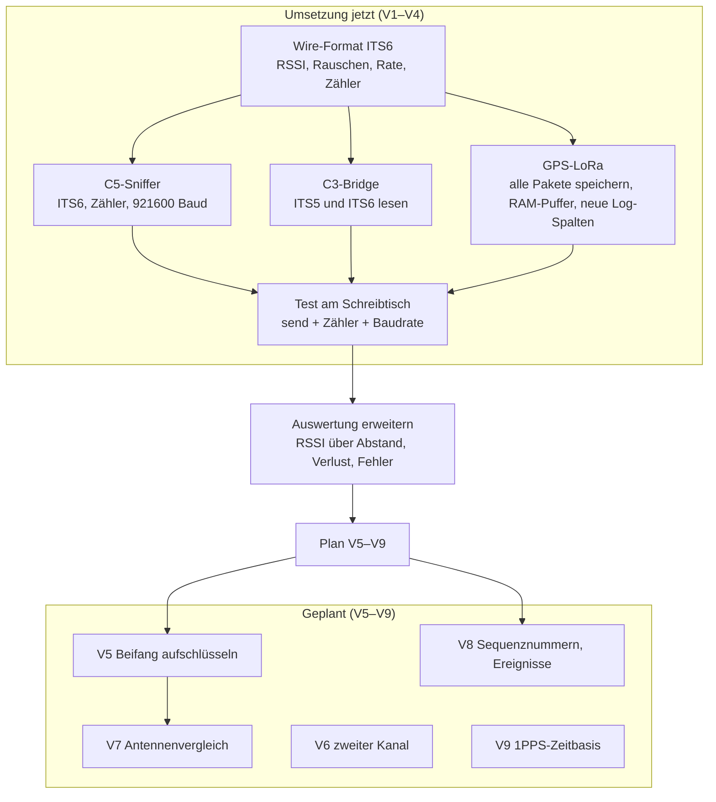

# 22 · Plan und Umsetzung der Verbesserungen V1–V9

Grundlage: [21 · Testfahrt 1: Timeline, Karte, Verbesserungen](21-testfahrt-1-timeline-karte-verbesserungen.md) (dort auch die Begründungen und Quellen). Hier steht, **was in welcher Reihenfolge umgesetzt wird, wie es getestet wird und wo es im Git-Repo landet.**

Mermaid-Quelltext

## Stand

| Nr | Vorschlag | Status | Git |
|---|---|---|---|
| V1 | Alle Pakete speichern | **umgesetzt** (GPS-LoRa geflasht), Praxistest mit C5 offen | `1d8c5fd` |
| V2 | RSSI, Rauschpegel, Rate im ITS-Strom | **umgesetzt** (Patch gebaut, **noch nicht auf dem C5**), Test offen | `9af22b8`, `1d8c5fd` |
| V3 | Baudrate 921 600 und Verlustzähler | **umgesetzt** (Patch gebaut, noch nicht auf C5/C3), Test offen | `9af22b8`, `1d8c5fd` |
| V4 | Fehlerhafte und Unicast-Pakete zählen | **umgesetzt** (Patch gebaut, noch nicht auf dem C5), Test offen | `9af22b8` |
| V5 | Beifang aufschlüsseln | **geplant** | – |
| V6 | Zweiter Empfangskanal | zurückgestellt | – |
| V7 | Antennenvergleich | geplant, nach V2 und Hardware | – |
| V8 | Sequenznummern, Ereignisverfolgung | geplant, nach V1 | – |
| V9 | 1PPS-Zeitbasis | zurückgestellt | – |

**Neu dazu (08.11.2026):** Die Analyse in [23](23-tempus-nachfolge-und-erweiterungen.md) zeigt, warum die zweite Messfahrt **V1 braucht**: 249 von 277 „sonstigen“ Paketen der ersten Fahrt kamen neben einer TEMPUS-Ampel mit ITS-G5-Hybrid-RSU an, wurden aber nicht gespeichert. Ziel der Fahrt 2: dieselbe Stelle (B 2 R / Petuelring, Schleißheimer Straße) mit allen Paketen und RSSI.

## Offene Schritte V1–V4 (Hardware am Schreibtisch)
1. C5 flashen: `firmware/build.sh` (wendet Patch 0001 und 0002 an), `./build.sh flash-c5 /dev/ttyACM0` (nur C5 am USB, keine 5 V am Prepboard).
2. C3 flashen (nur wenn die Trafik-CPU mitläuft): `./build.sh flash-c3 /dev/ttyUSB0`.
3. Test: C5-Shell `send` und `stats`; Statusseite der GPS-LoRa zeigt Feldstärke −42 dBm (Testpaket), Fehler- und Verlustzähler; 100 Testpakete am Stück ohne Verlust bei 921 600 Baud.
4. Ergebnis hier eintragen und V1–V4 auf „getestet“ setzen.

## Entwurf V1–V4

**Neues Format `ITS6`** zwischen Sniffer und den beiden Empfängern (C3-Bridge, GPS-LoRa). `ITS5` bleibt lesbar, damit alte Mitschnitte und der Upstream-Strom weiter funktionieren.

| Offset | Größe | Feld |
|---|---|---|
| 0 | 4 | Magic `ITS6` |
| 4 | 4 | Sekunden (LE) |
| 8 | 4 | Mikrosekunden (LE) |
| 12 | 2 | Länge der Nutzlast (LE) |
| 14 | 1 | `rssi` (int8, dBm; 127 = unbekannt) |
| 15 | 1 | `noise_floor` (int8, dBm; 127 = unbekannt) |
| 16 | 1 | `rate` (uint8, Rate-Feld aus L-SIG) |
| 17 | 1 | `kind`: 0 = 802.11-Paket, 1 = Statistik |
| 18 | Länge | Nutzlast. Bei `kind` 1: drei uint32 (LE), **kumulativ seit Start**: `rx_err`, `unicast`, `dropped` |

- **rx_err (V4):** Pakete, die der Treiber mit `rx_state` ≠ 0 meldet (u. a. Prüfsummenfehler). Dafür darf der Filter sie nicht mehr aussortieren. Sie werden **nur gezählt**, nicht weitergegeben.
- **unicast (V4):** Pakete, deren Zieladresse nicht Broadcast ist. Nur gezählt.
- **dropped (V3):** Pakete, die in der Warteschlange des Sniffers keinen Platz fanden.
- **Statistikrahmen:** jede Sekunde.
- **Baudrate (V3):** 921 600 statt 115 200 auf der Leitung C5 → C3/GPS-LoRa. Per Build-Flag `ITS_BAUD` einstellbar, damit ein Rückfall auf 115 200 möglich ist.
- **GPS-LoRa (V1):** Alle Pakete in `frames.bin` (als ITS6), über einen RAM-Puffer, damit das Schreiben ins Flash den UART-Empfang nicht blockiert. UART-Empfangspuffer 16 kB. Grenze 4 MB, Reserve 300 kB bleibt.
- **`log.csv`:** hinten 7 neue Spalten: `rssi_avg, rssi_min, rssi_max, rx_err, unicast, dropped, bad`. Die Spalten 1–13 bleiben unverändert. (`bad` = ungültige Rahmen am Empfänger.)

### Tests

| Ebene | Test |
|---|---|
| PC | `pio test -e native`: ITS5- und ITS6-Parser, Statistikrahmen, Fehlerrahmen |
| PC | Decoder-Tests: `itsfile`-Leser liest ITS5 und ITS6 |
| Schreibtisch | C5 `send`-Befehl: Paket kommt mit Rate und RSSI-Platzhalter an |
| Schreibtisch | Zähler: Baudrate 921 600 am Draht, kein Verlust bei 100 Paketen am Stück |
| Schreibtisch | Mitschnitt füllt sich, Statusseite zeigt neue Werte |
| Feld | echte Fahrt: RSSI über Abstand, Fehler- und Verlustquote |

### Git-Plan

1. Plan und Format (dieses Dokument) – Commit „Plan“.
2. Parser, Format und Tests (PC) – Commit „ITS6 Parser“.
3. Sniffer- und Bridge-Patch `0002` – Commit „Firmware C5/C3“.
4. GPS-LoRa-Firmware – Commit „GPS-LoRa V1–V4“.
5. Auswertungsskripte und Decoder – Commit „Auswertung ITS6“.
6. Doku-Stand und Statustabelle – Commit „Doku“.

## Plan V5–V9

| Nr | Schritte | Abhängigkeit | Test | Fertig, wenn |
|---|---|---|---|---|
| **V5** Beifang | 1. Zähler je Ethertype, Basic-Header-NH, GN-Header-Typ, BTP-Port in `its_parse.h`. 2. Je Klasse die ersten 5 Pakete speichern. 3. Spalte `top_ports` in `log.csv`. 4. Tabelle der Ports aus ETSI TS 103 248. | V1 | native Tests mit je einem Testpaket pro Klasse; Replay des bereinigten Mitschnitts | jede Klasse hat einen Namen, „sonstige“ ist < 5 % |
| **V7** Antenne | 1. Zwei Antennen beschaffen (WROOM-1U-Board, GSA.8859). 2. Messfahrt A/B an derselben Strecke. 3. Median-RSSI je Abstandsklasse auswerten. | V2, Hardware | gleiche Strecke zweimal, Wetter notieren | Tabelle RSSI je 100 m für beide Antennen |
| **V8** Auswertung | 1. Sequenznummern je Sender, Verlustquote. 2. DENM-Ereignisse über `actionID` zusammenführen. 3. Anzeige im Dashboard. | V1 | Replay von `frames.bin` | Verlustquote je Sender in der Auswertung |
| **V6** zweiter Kanal | 2. C5 mit `CHANNEL = 5880`, zweiter Port. | nur bei Bedarf | – | zurückgestellt |
| **V9** 1PPS | PPS-Pin des GPS in die GPS-LoRa, Zeitstempel auf PPS beziehen. | nur bei Bedarf | – | zurückgestellt |

**Reihenfolge:** V1–V4 → Schreibtischtest → Messfahrt 2 (mit RSSI) → V5 und V8 anhand der Daten → V7 (Antennenvergleich).
