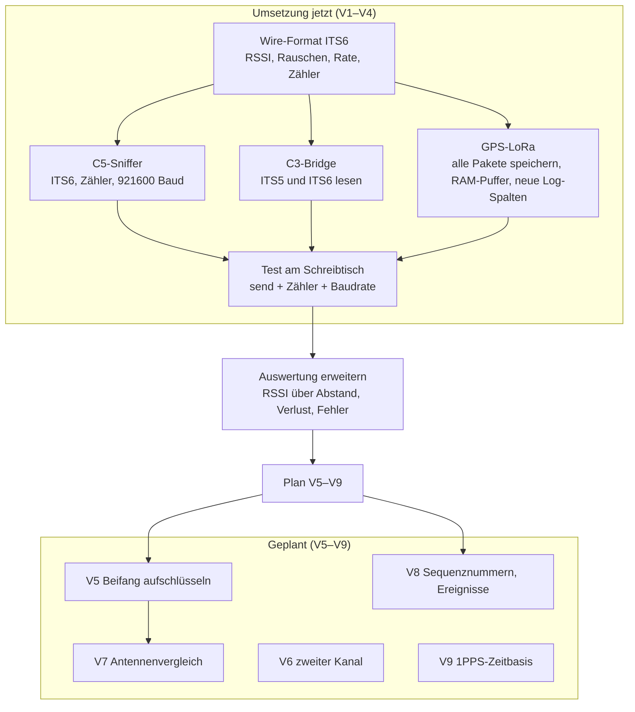

# 22 · Plan und Umsetzung der Verbesserungen V1–V9

Grundlage: [21 · Testfahrt 1: Timeline, Karte, Verbesserungen](21-testfahrt-1-timeline-karte-verbesserungen.md) (dort auch die Begründungen und Quellen). Hier steht, **was in welcher Reihenfolge umgesetzt wird, wie es getestet wird und wo es im Git-Repo landet.**

Mermaid-Quelltext

## Stand

| Nr | Vorschlag | Status | Git |
|---|---|---|---|
| V1 | Alle Pakete speichern | **umgesetzt**; verlustfrei bei Pausen zwischen den Paketströmen, **bekannte Schwäche** bei Strömen während des Schreibens (siehe Abschnitt „Test 09.11.2026“) | `1d8c5fd` |
| V2 | RSSI, Rauschpegel, Rate im ITS-Strom | **getestet** (Testpaket mit −42 dBm kommt an), Feldtest mit echter RSSI offen | `9af22b8`, `1d8c5fd` |
| V3 | Baudrate 921 600 und Verlustzähler | **getestet** (Leitung verlustfrei bis 333 Pakete/s, Verlustzähler stimmt); C3 umgestellt und getestet (siehe unten) | `9af22b8`, `1d8c5fd` |
| V4 | Fehlerhafte und Unicast-Pakete zählen | **umgesetzt**, Zähler stehen auf 0 (am Schreibtisch kein Funkverkehr); Feldtest offen | `9af22b8` |
| V5 | Beifang aufschlüsseln | **geplant** | – |
| V6 | Zweiter Empfangskanal | zurückgestellt | – |
| V7 | Antennenvergleich | geplant, nach V2 und Hardware | – |
| V8 | Sequenznummern, Ereignisverfolgung | geplant, nach V1 | – |
| V9 | 1PPS-Zeitbasis | zurückgestellt | – |

**Neu dazu (08.11.2026):** Die Analyse in [23](23-tempus-nachfolge-und-erweiterungen.md) zeigt, warum die zweite Messfahrt **V1 braucht**: 249 von 277 „sonstigen“ Paketen der ersten Fahrt kamen neben einer TEMPUS-Ampel mit ITS-G5-Hybrid-RSU an, wurden aber nicht gespeichert. Ziel der Fahrt 2: dieselbe Stelle (B 2 R / Petuelring, Schleißheimer Straße) mit allen Paketen und RSSI.

## Test 09.11.2026 (C5 + GPS-LoRa am Server)

Der C5 hat dafür den Befehl `burst <n> <len> [Abstand_ms]` bekommen (Patch 0002): Er erzeugt nummerierte Testpakete, ohne Abstand schneller als die Warteschlange abfließt.

| Test | Ergebnis |
|---|---|
| Einzelpaket `send` | kommt als ITS6 an, RSSI −42 dBm, Rauschpegel −95 dBm |
| 100 Pakete (je 66 Byte) per Shell | 100 von 100, Reihenfolge und Inhalt korrekt, `bad` 0 |
| Leitung 921 600 Baud, 376-Byte-Pakete mit 3, 5, 10 ms Abstand (333, 200, 100 Pakete/s) | in der Messreihe mit leerem Flash und großem RAM-Puffer **500 von 500, 0 Verlust** |
| Überlast (ohne Abstand, Warteschlange läuft über) | C5 meldet 206 verworfen, GPS-LoRa empfängt genau die 294 eingereihten: **Verlustzähler stimmt** (V3) |
| Prüfsummenfehler, Unicast | 0 (am Schreibtisch kein ITS-G5-Verkehr) |

**Wichtiger Befund (Schreibpfad):** Mit der ersten Fassung (Paket für Paket oder in 8-kB-Stücken ins Flash schreiben, UART-Puffer 16 kB) gingen schon bei **50 Paketen/s etwa 25 % verloren**, ohne dass `bad` oder `lost` etwas zeigten. Der Prozessor hält während eines Flash-Schreibvorgangs (einige 10 bis 300 ms) den UART-Interrupt an, der Hardware-FIFO (128 Byte) läuft über und die Pakete fehlen **still**. Das betrifft auch die Mitschnitte der ersten Fahrt (altes Schreiben je Paket); dort lag der Verkehr bei höchstens 11 Paketen/s, der Verlust ist unbekannt.

**Stand der Firmware nach den Tests (Commit siehe Git):**
- 1 MB Schreibpuffer im PSRAM; ins Flash wird **nur nach mindestens 3 s Funkstille** geschrieben, in 4-kB-Häppchen mit 300 ms Wartezeit danach; Logzeilen liegen im RAM und gehen höchstens alle 60 s ins Flash.
- UART-Empfangspuffer 64 kB, blockweises Lesen (Byte für Byte war bei 921 600 Baud zu langsam).
- Diagnose im `/api`: FIFO-Überläufe je Tätigkeit (`ovfp`), längste Schleifenpause, längstes Flash-Häppchen, LoRa-Sendedauer (`summax`, 3 s).

**Messergebnis (leeres Flash, C5 sendet nummerierte 376-Byte-Pakete):**

| Reihe | Ergebnis |
|---|---|
| 6 Läufe mit 200 Paketen (50/s), 4 Läufe 300 und 175 Pakete (100, 200, 333/s und Überlast), je 3 s Pause davor | **2 275 von 2 275 Paketen**, 0 Verlust, 0 FIFO-Überläufe |
| 12 Läufe mit 200 Paketen (50/s), 2 s Pause | 2 397 von 2 400 (3 Verluste durch 2 FIFO-Überläufe) |
| Überlast (Warteschlange des Sniffers läuft über) | C5-Zähler und Empfang stimmen genau überein |
| **4 Läufe unmittelbar nach den obigen, solange der Rückstand im Puffer ins Flash geschrieben wird** (Pause 0–0,3 s) | **62, 148, 114, 119 Pakete fehlen** (bis 77 %), FIFO-Überläufe zählen die Tätigkeit „Flash-Häppchen“ |

**Deutung (Hypothese, nicht bewiesen):** Beginnt ein Paketstrom, während gerade ein Flash-Häppchen geschrieben wird, läuft der FIFO über. Die Zahlen zeigen Verluste, die größer sind als ein einzelnes Häppchen erklärt; ich vermute, dass der Arduino-UART-Treiber nach einem Überlauf den Empfangspuffer verwirft. Das habe ich nicht im Treibercode geprüft.

**Abschätzung für die Fahrt (Rechnung, keine Messung):** Auf der ersten Fahrt kamen 2 168 Pakete in 4,2 h an (ein Paket alle 7 s). Das Schreiben des Rückstands belegt rund 200 Häppchen zu höchstens 0,3 s, das sind etwa 1 min von 4,2 h (0,4 %); damit liegt der erwartete Verlust bei sparsamem Verkehr in dieser Größenordnung. **Bei dichtem Verkehr, der oft ohne 3 s Pause bleibt, wächst der Rückstand im RAM und wird erst bei 90 % Füllung oder nach 10 min geschrieben** – dann tritt der beschriebene Verlust auf.

**Bessere Lösung (nicht umgesetzt):** Hardware-Flusssteuerung. Die GPS-LoRa meldet dem C5 über einen zusätzlichen Draht (RTS → CTS des C5), wann sie nicht lesen kann. Dann gehen auch Flash-Schreibvorgänge nicht verloren. Das braucht eine Drahtverbindung mehr und eine Anpassung im Sniffer.

**Ungeklärt:** Der Fehlerzähler `uerr` zeigte in einer Messreihe 450 Fehler anderer Art (nicht Break, Parity oder Frame in der darauffolgenden Reihe). Ursache offen.

## Offene Schritte V1–V4 (Hardware am Schreibtisch)
1. C5 flashen: `firmware/build.sh` (wendet Patch 0001 und 0002 an), `./build.sh flash-c5 /dev/ttyACM0` (nur C5 am USB, keine 5 V am Prepboard).
2. C3 flashen (nur wenn die Trafik-CPU mitläuft): `./build.sh flash-c3 <port>` (Port per `ls -l /dev/serial/by-id/`).
3. Test: C5-Shell `send` und `stats`; Statusseite der GPS-LoRa zeigt Feldstärke −42 dBm (Testpaket), Fehler- und Verlustzähler; 100 Testpakete am Stück ohne Verlust bei 921 600 Baud.
4. Ergebnis hier eintragen und V1–V4 auf „getestet“ setzen.

## Entwurf V1–V4

**Neues Format `ITS6`** zwischen Sniffer und den beiden Empfängern (C3-Bridge, GPS-LoRa). `ITS5` bleibt lesbar, damit alte Mitschnitte und der Upstream-Strom weiter funktionieren.

| Offset | Größe | Feld |
|---|---|---|
| 0 | 4 | Magic `ITS6` |
| 4 | 4 | Sekunden (LE) |
| 8 | 4 | Mikrosekunden (LE) |
| 12 | 2 | Länge der Nutzlast (LE) |
| 14 | 1 | `rssi` (int8, dBm; 127 = unbekannt) |
| 15 | 1 | `noise_floor` (int8, dBm; 127 = unbekannt) |
| 16 | 1 | `rate` (uint8, Rate-Feld aus L-SIG) |
| 17 | 1 | `kind`: 0 = 802.11-Paket, 1 = Statistik |
| 18 | Länge | Nutzlast. Bei `kind` 1: drei uint32 (LE), **kumulativ seit Start**: `rx_err`, `unicast`, `dropped` |

- **rx_err (V4):** Pakete, die der Treiber mit `rx_state` ≠ 0 meldet (u. a. Prüfsummenfehler). Dafür darf der Filter sie nicht mehr aussortieren. Sie werden **nur gezählt**, nicht weitergegeben.
- **unicast (V4):** Pakete, deren Zieladresse nicht Broadcast ist. Nur gezählt.
- **dropped (V3):** Pakete, die in der Warteschlange des Sniffers keinen Platz fanden.
- **Statistikrahmen:** jede Sekunde.
- **Baudrate (V3):** 921 600 statt 115 200 auf der Leitung C5 → C3/GPS-LoRa. Per Build-Flag `ITS_BAUD` einstellbar, damit ein Rückfall auf 115 200 möglich ist.
- **GPS-LoRa (V1):** Alle Pakete in `frames.bin` (als ITS6), über einen RAM-Puffer, damit das Schreiben ins Flash den UART-Empfang nicht blockiert. UART-Empfangspuffer 16 kB. Grenze 4 MB, Reserve 300 kB bleibt.
- **`log.csv`:** hinten 7 neue Spalten: `rssi_avg, rssi_min, rssi_max, rx_err, unicast, dropped, bad`. Die Spalten 1–13 bleiben unverändert. (`bad` = ungültige Rahmen am Empfänger.)

### Tests

| Ebene | Test |
|---|---|
| PC | `pio test -e native`: ITS5- und ITS6-Parser, Statistikrahmen, Fehlerrahmen |
| PC | Decoder-Tests: `itsfile`-Leser liest ITS5 und ITS6 |
| Schreibtisch | C5 `send`-Befehl: Paket kommt mit Rate und RSSI-Platzhalter an |
| Schreibtisch | Zähler: Baudrate 921 600 am Draht, kein Verlust bei 100 Paketen am Stück |
| Schreibtisch | Mitschnitt füllt sich, Statusseite zeigt neue Werte |
| Feld | echte Fahrt: RSSI über Abstand, Fehler- und Verlustquote |

### Git-Plan

1. Plan und Format (dieses Dokument) – Commit „Plan“.
2. Parser, Format und Tests (PC) – Commit „ITS6 Parser“.
3. Sniffer- und Bridge-Patch `0002` – Commit „Firmware C5/C3“.
4. GPS-LoRa-Firmware – Commit „GPS-LoRa V1–V4“.
5. Auswertungsskripte und Decoder – Commit „Auswertung ITS6“.
6. Doku-Stand und Statustabelle – Commit „Doku“.

## Plan V5–V9

| Nr | Schritte | Abhängigkeit | Test | Fertig, wenn |
|---|---|---|---|---|
| **V5** Beifang | 1. Zähler je Ethertype, Basic-Header-NH, GN-Header-Typ, BTP-Port in `its_parse.h`. 2. Je Klasse die ersten 5 Pakete speichern. 3. Spalte `top_ports` in `log.csv`. 4. Tabelle der Ports aus ETSI TS 103 248. | V1 | native Tests mit je einem Testpaket pro Klasse; Replay des bereinigten Mitschnitts | jede Klasse hat einen Namen, „sonstige“ ist < 5 % |
| **V7** Antenne | 1. Zwei Antennen beschaffen (WROOM-1U-Board, GSA.8859). 2. Messfahrt A/B an derselben Strecke. 3. Median-RSSI je Abstandsklasse auswerten. | V2, Hardware | gleiche Strecke zweimal, Wetter notieren | Tabelle RSSI je 100 m für beide Antennen |
| **V8** Auswertung | 1. Sequenznummern je Sender, Verlustquote. 2. DENM-Ereignisse über `actionID` zusammenführen. 3. Anzeige im Dashboard. | V1 | Replay von `frames.bin` | Verlustquote je Sender in der Auswertung |
| **V6** zweiter Kanal | 2. C5 mit `CHANNEL = 5880`, zweiter Port. | nur bei Bedarf | – | zurückgestellt |
| **V9** 1PPS | PPS-Pin des GPS in die GPS-LoRa, Zeitstempel auf PPS beziehen. | nur bei Bedarf | – | zurückgestellt |

**Reihenfolge:** V1–V4 → Schreibtischtest → Messfahrt 2 (mit RSSI) → V5 und V8 anhand der Daten → V7 (Antennenvergleich).

## Test mit allen drei Geräten (09.11.2026)

Aufbau: C5 (Sniffer) sendet mit dem Shell-Befehl `burst <n> 376 <Abstand_ms>` nummerierte Testpakete über den Draht; C3-Bridge (Patch 0002) und GPS-LoRa (XIAO) zählen mit. Die Sniffer-Zähler (`stats`) blieben bei `rx_err=0 unicast=0 dropped=0`.

| Lauf | gesendet | GPS-LoRa | C3 |
|---|---|---|---|
| 50 Pakete/s (20 ms), Firmware 0002 | 200 | 200 | **87** |
| 20 Pakete/s (50 ms), Firmware 0002 | 200 | 200 | 200 |
| 50 Pakete/s (20 ms), Firmware 0002 + 0003 | 200 | 200 | **200** |
| 200 Pakete/s (5 ms), Firmware 0002 + 0003 | 300 | – | 257 |

**Ursache des C3-Verlusts (aus dem Quelltext abgeleitet, durch den Test bestätigt):** Die Hauptschleife des Upstream-Codes liest pro Durchlauf höchstens ein Paket und wartet danach pauschal `delay(50)`. Das ergibt höchstens 20 Pakete/s. Der UART-Puffer (8 192 Byte) fasst etwa 20 Pakete à 394 Byte. Bei 200 Paketen in 4 s ergibt sich rechnerisch etwa 80 verarbeitet + 20 gepuffert, gemessen waren zweimal genau 87.

**Patch `0003-c3-schleife-drain.patch`:** Die Pause von 50 ms gilt nur noch bei leerem UART-Puffer; der Puffer wächst auf 32 768 Byte. Bei 200 Paketen/s bleibt ein Verlust (257 von 300), vermutlich durch Konsolenausgabe und MQTT-Publish je Paket. Die Ursache ist nicht gemessen. Echter Verkehr liegt auf der ersten Testfahrt im Mittel bei etwa einem Paket alle 7 s.

### MQTT-Weg C3 → Server (09.11.2026)

- Das Flashen des C3-Dateisystems (`uploadfs`) löscht die Konfiguration: `mqtt_broker_host` war danach leer, die WLAN-Zugangsdaten blieben erhalten. Nach jedem `flash-c3` MQTT neu eintragen, hier zu Hause per `POST /config` mit `mqtt_protocol=mqtt`, `mqtt_broker_host=<NUC>`, `mqtt_broker_port=1885` und danach `reboot` in der C3-Shell.
- Ergebnis: 100 vom C5 gesendete Testpakete (50 ms Abstand) kamen als 100 Nachrichten auf `its/<id>/packet` am Broker an. Der Decoder zählte 100 Frames; sie sind als „undecoded“ gezählt, weil die Testpakete keine echten ITS-Nachrichten sind.
- Der MQTT-Strom enthält nur das 802.11-Paket. RSSI und die Sniffer-Zähler (`ITS6`) gehen hier nicht mit; die C3 wertet `its6_stats` bisher nicht aus.

### LoRa-Weg XIAO → ChirpStack (09.11.2026)

- Zuerst kam nichts an: Das Einkanal-Gateway war ausgeschaltet. Das XIAO sendete trotzdem (Zähler `uplinks` stieg einmal je Minute, Status 0). Das Gateway ist im ABP-Betrieb kein Problem für die Verbindung, es fehlten nur die Uplinks dieser Zeit.
- Nach dem Einschalten kam jede Minute ein Uplink an (Anwendung `IceTraffic`, Gerät `ice-car`, Port 2, DR3, RSSI −34/−35 dBm, SNR 13,5/12,8 dB am Schreibtisch). Der Nutzlast-Decoder liefert die Felder (cam, denm, spatem, mapem, secured, other, gps_fix, satellites, speed_kmh, bridge_alive, uptime_min).
- Die Werte stimmen mit der Statusseite des XIAO überein (GPS-Fix, Satellitenzahl, `bridge_alive`). Die CAM/DENM-Zähler blieben 0, weil die Testpakete keine echten ITS-Nachrichten sind.

Nicht getestet: die Auswertung von `its6_stats` auf der C3 und LoRa-Empfang mit echten CAM/DENM-Zählern.
