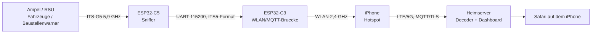
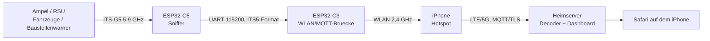
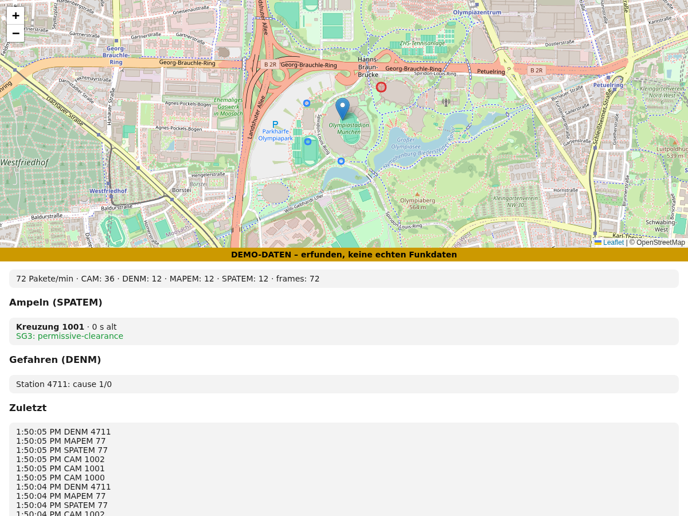

# Ice-Traffic-Data

Mobiler Empfang von **C-ITS / ITS-G5 (802.11p)** Verkehrsdaten im Auto – Ampeldaten (SPATEM/MAPEM), Fahrzeugmeldungen (CAM) und Gefahrenmeldungen (DENM) – mit zwei günstigen ESP32-Boards und Anzeige über das iPhone.

> **Status:** Firmware (C5 + C3) und lokaler Decoder bauen/laufen; Decoder mit synthetischen Daten getestet. Hardware (DigiKey) ist bestellt, **echte Funkdaten stehen noch aus**. Auch als Webseite: <https://icepaule.github.io/Ice-Traffic-Data/>. Offene Punkte stehen in [docs/07-offene-punkte.md](07-offene-punkte.md).

## Idee in einem Bild

Mermaid-Quelltext

## So sieht das Dashboard aus (Demo-Daten)

## Anleitung (Schritt für Schritt)

| Schritt | Thema |
|---|---|
| 0 | [Architektur, Setup und Datenfluss (Mermaid)](00-architektur.md) |
| 1 | [Grundlagen: Verkehrsdaten-Techniken & Nachrichtentypen](01-grundlagen.md) |
| 2 | [Hardware & Einkaufsliste](02-hardware.md) |
| 3 | [Verdrahtung](03-verdrahtung.md) |
| 4 | [Firmware bauen & flashen](04-firmware.md) |
| 5 | [iPhone-Hotspot & MQTT](05-iphone-mqtt.md) |
| 6 | [Testfahrt München / Ottobrunn](06-testfahrt.md) |
| 7 | [Offene Punkte & Ausbau](07-offene-punkte.md) |
| 8 | [Anbindung an den Heimserver (DDNS, TLS-MQTT)](08-heimserver.md) |
| 9 | [Lokaler Decoder & Dashboard](09-decoder.md) |
| 10 | [Analyse: LoRa(WAN) vom Auto nach Hause](10-lorawan.md) |
| 11 | [Antennen](11-antennen.md) |
| 12 | [Stückliste & Bestellung DigiKey](12-bestellung.md) |
| 13 | [Dashboard öffentlich (its.mpauli.de, Vorlage THW-Barbeleg)](13-dashboard-veroeffentlichen.md) |
| 14 | [Inbetriebnahme & Vorbereitung ohne Hardware](14-inbetriebnahme.md) |
| 15 | [TEMPUS: Recherche & Unterstützungsangebot (Mail-Entwurf)](15-tempus.md) |
| 16 | [ToDo nach Liefereingang & Zugänge](16-todo-nach-lieferung.md) |
| 17 | [Umsetzungsplan (Phasen 0–9, mit Teilen)](17-umsetzungsplan.md) |
| 18 | [Stand Schreibtischtest, Statusseite & Mitschnitt](18-schreibtischtest-und-mitschnitt.md) |
| 19 | [Gehäuse (3D-Druck, SolidWorks-STEP)](19-gehaeuse.md) |
| 20 | [Auswertung der ersten Testfahrt (echte CAM/DENM, Beifang)](20-auswertung-testfahrt-1.md) |
| 21 | [Testfahrt 1: Empfangs-Timeline, Karte, Verbesserungen](21-testfahrt-1-timeline-karte-verbesserungen.md) |
| 22 | [Plan und Umsetzung Verbesserungen V1–V9](22-plan-verbesserungen.md) |
| 23 | [TEMPUS-Nachfolge, heutige Einsätze, Erweiterungen](23-tempus-nachfolge-und-erweiterungen.md) |

## Quellen

- Firmware: <https://github.com/bertrik/its-g5-receiver> (Ordner `esp32-c5-sniffer/`, `esp32-c3-bridge/`)
- Projektbeschreibung des Autors: <https://revspace.nl/Its-g5>
- OpenTrafficMap Wiki: <https://wiki.opentrafficmap.org>
- Alternative (Android): V2X2MAP, CITS-to-go
